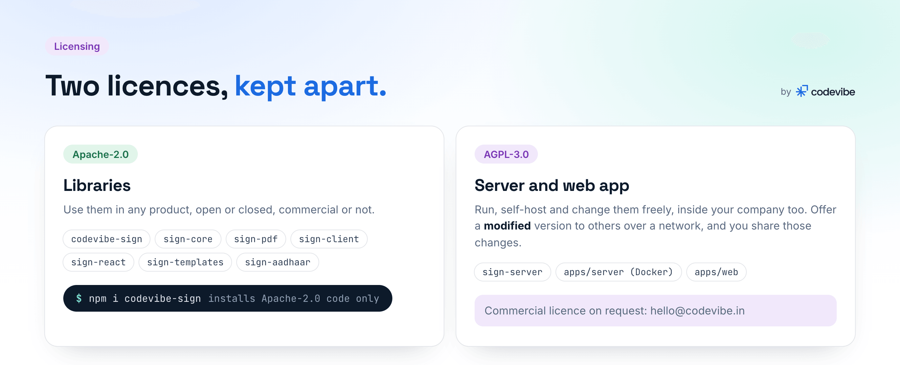

# Licensing

Codevibe Sign is open source under two licences. Which one applies depends on the part you use,
and the two are kept apart: no Apache-2.0 package contains or depends on AGPL code.

  

| Part                                                                                                                                                          | Licence                                | What it means for you                                                                                                                                                                                                               |
| ------------------------------------------------------------------------------------------------------------------------------------------------------------- | -------------------------------------- | ----------------------------------------------------------------------------------------------------------------------------------------------------------------------------------------------------------------------------------- |
| Libraries: `codevibe-sign`, `@codevibe_technology/sign-core`, `sign-pdf`, `sign-react`, `sign-client`, `sign-templates` and `sign-aadhaar`, plus the examples | [Apache-2.0](LICENSES/Apache-2.0.txt)  | Use them in any project, open or closed, commercial or not. Keep the licence and the [NOTICE](NOTICE) file with copies you distribute.                                                                                              |
| Server and apps: `@codevibe_technology/sign-server`, `apps/server` (the Docker image) and the web app (`apps/web`); each carries its own `LICENSE` file       | [AGPL-3.0-only](LICENSES/AGPL-3.0.txt) | Use, self-host and change them freely, including inside your company. If you let other people use a **modified** version over a network (for example as a hosted service), you must offer them your changes under the same licence. |
| Docs site (`apps/site`) and playground (`apps/playground`), both private and not published to npm                                                             | [Apache-2.0](LICENSE)                  | Use and change them freely.                                                                                                                                                                                                         |

## What each install gives you

| You run                                                                                                               | You get                                                                                                                                         | Licence                                     |
| --------------------------------------------------------------------------------------------------------------------- | ----------------------------------------------------------------------------------------------------------------------------------------------- | ------------------------------------------- |
| `npm i codevibe-sign`                                                                                                 | The API client, PDF tools, core rules, React components and the `codevibe-sign` command line (`verify`, `inspect`, `keygen`, `hash`, `api-key`) | Apache-2.0 only                             |
| `npm i @codevibe_technology/sign-core` (or `sign-pdf`, `sign-client`, `sign-react`, `sign-templates`, `sign-aadhaar`) | That library                                                                                                                                    | Apache-2.0 only                             |
| `npm i @codevibe_technology/sign-server` or `npx @codevibe_technology/sign-server start`                              | The HTTP API, the signing runtime and the `codevibe-sign-server` command                                                                        | AGPL-3.0-only, with Apache-2.0 dependencies |
| The Docker image, or `deploy/`                                                                                        | The standalone service, or the whole web app                                                                                                    | AGPL-3.0-only                               |

`codevibe-sign` does not re-export the server, has no `start` command and does not list
`@codevibe_technology/sign-server` among its dependencies. Self-hosting means the Docker image
or `npx @codevibe_technology/sign-server start`.

## Common questions

Running the unmodified server or app for your own organisation, or calling its API from your own
closed-source product, does not require you to publish anything. Talking to the server over HTTP
with `codevibe-sign` or `@codevibe_technology/sign-client` keeps your product under whatever
licence you choose.

Importing `@codevibe_technology/sign-server` into your own program makes that program a work
that includes AGPL code. If you offer it to others over a network, the AGPL asks you to share
its source. Run the server as its own service if you want to keep your code separate.

If the AGPL does not fit how you want to use the server or app, contact hello@codevibe.in about
a commercial licence. Codevibe Technology Private Limited can offer one because contributors
sign a [contributor licence agreement](CONTRIBUTING.md#contributor-licence-agreement).

The names and logos are covered separately by [TRADEMARKS.md](TRADEMARKS.md).

---

  <a href="https://codevibe.in?utm_source=github&utm_medium=readme&utm_campaign=codevibe-sign&utm_content=footer-logo">
    <picture>
      <source media="(prefers-color-scheme: dark)" srcset=".github/assets/codevibe-logo-light.png">
      
    </picture>
  </a>

  Built and maintained by <a href="https://codevibe.in?utm_source=github&utm_medium=readme&utm_campaign=codevibe-sign&utm_content=built-by"><b>Codevibe</b></a>, a software development agency in Gurugram, India. 
  <a href="https://sign.codevibe.in?utm_source=github&utm_medium=readme&utm_campaign=codevibe-sign&utm_content=footer-links">Codevibe Sign</a> · <a href="https://sign.codevibe.in/docs?utm_source=github&utm_medium=readme&utm_campaign=codevibe-sign&utm_content=footer-links">Docs</a> · <a href="https://codevibe.in/tools/codevibe-sign?utm_source=github&utm_medium=readme&utm_campaign=codevibe-sign&utm_content=footer-links">Product page</a> · <a href="mailto:hello@codevibe.in">hello@codevibe.in</a>

