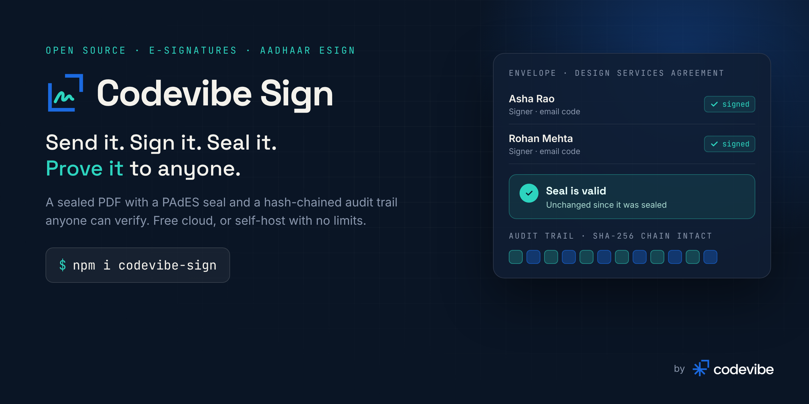
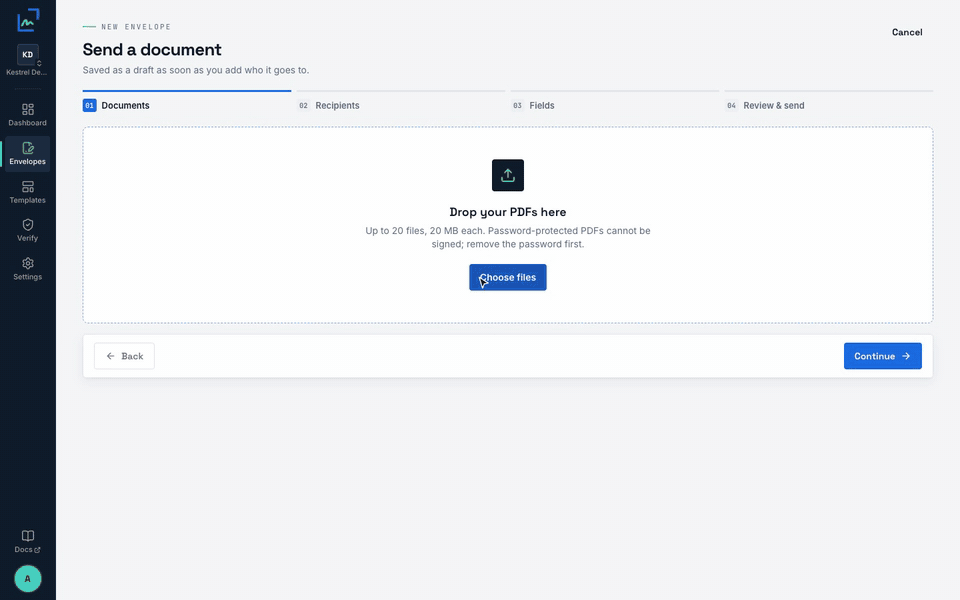
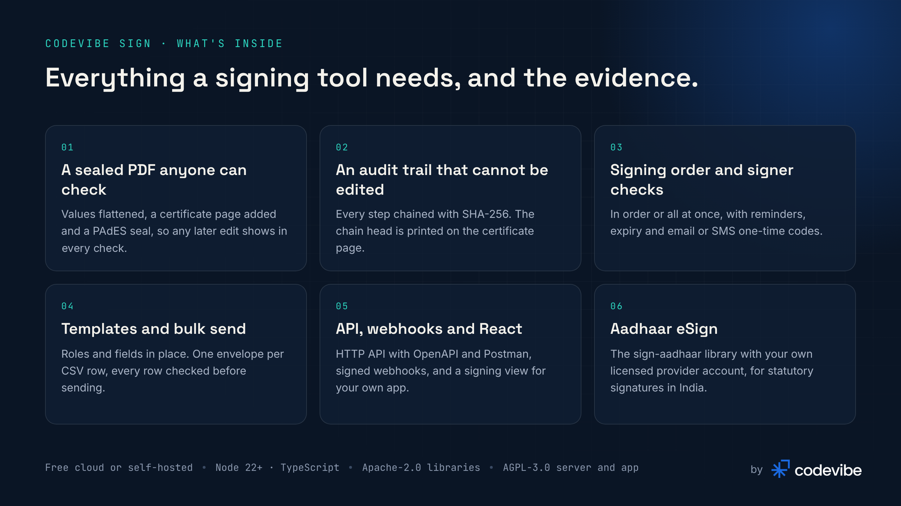
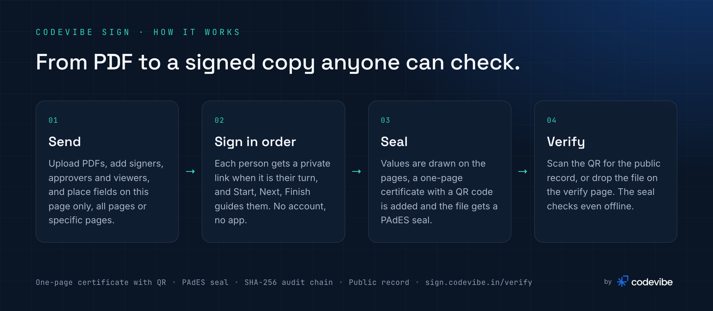
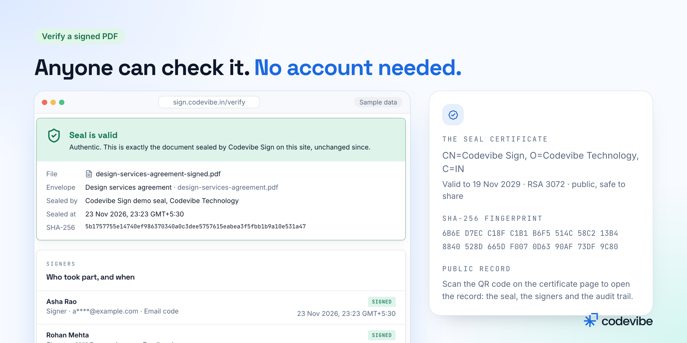
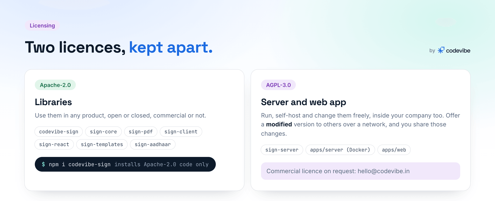

<p align="center">
  <a href="https://sign.codevibe.in?utm_source=github&utm_medium=readme&utm_campaign=codevibe-sign&utm_content=banner"></a>
</p>

<p align="center">
  <a href="https://github.com/codevibe-technology/codevibe-sign/actions/workflows/ci.yml"></a>
  <a href="LICENSING.md"></a>
  <a href="LICENSING.md"></a>
  
  
  
  <a href="https://sign.codevibe.in?utm_source=github&utm_medium=readme&utm_campaign=codevibe-sign&utm_content=badge"></a>
</p>

<p align="center">
  <b>Upload a PDF, add who signs, place the fields and send. People sign in their browser, with no account,<br>and you get back one sealed PDF with a certificate page and an audit trail anyone can check, even offline.</b>
</p>

<p align="center">
  
</p>

<p align="center">
  <a href="#get-started">Get started</a> ·
  <a href="#features">Features</a> ·
  <a href="#how-it-works">How it works</a> ·
  <a href="#verify-a-signed-pdf">Verify a PDF</a> ·
  <a href="#plans">Plans</a> ·
  <a href="#packages">Packages</a> ·
  <a href="#using-the-libraries">Libraries</a> ·
  <a href="#self-hosting">Self-hosting</a> ·
  <a href="#security">Security</a> ·
  <a href="#legal-note">Legal</a> ·
  <a href="#licensing">Licensing</a> ·
  <a href="#faq">FAQ</a> ·
  <a href="CHANGELOG.md">Changelog</a> ·
  <a href="https://sign.codevibe.in/docs?utm_source=github&utm_medium=readme&utm_campaign=codevibe-sign&utm_content=nav">Docs</a>
</p>

---

## Get started

Three ways in. Pick the one that fits, and switch later: the cloud and self-hosting run the same code.

<table>
  <tr>
    <th width="33%" align="left">☁️ Cloud</th>
    <th width="33%" align="left">🐳 Self-host</th>
    <th width="33%" align="left">📦 Libraries</th>
  </tr>
  <tr>
    <td valign="top">Create a free workspace at <a href="https://sign.codevibe.in?utm_source=github&utm_medium=readme&utm_campaign=codevibe-sign&utm_content=get-started">sign.codevibe.in</a>. A sample agreement is waiting in it, so you can send yourself a document and sign it in a minute. No card needed.</td>
    <td valign="top">The whole web app, its HTTP API and the docs, with PostgreSQL, behind your Traefik. No limits, and your documents never leave your server. See <a href="#self-hosting">Self-hosting</a> and <a href="deploy/README.md">deploy/README.md</a>.</td>
    <td valign="top">Build signing into your own Node or React app. <code>npm i codevibe-sign</code> gives you the API client, PDF tools, core rules, React components and a command line, all Apache-2.0. See <a href="#using-the-libraries">Using the libraries</a>.</td>
  </tr>
</table>

```sh
# Self-host the web app with Docker
git clone https://github.com/codevibe-technology/codevibe-sign.git
cd codevibe-sign/deploy
cp .env.example .env              # host name, Traefik, database, secrets, SMTP; PLAN_MODE=self-hosted
# create secrets/seal.p12 as described in deploy/README.md
docker compose up -d --build
```

```sh
# Or add the libraries to your app
npm i codevibe-sign
```

> **Pre-release.** The packages are under active development and the APIs may change before 1.0.

## Features

<p align="center">
  
</p>

- 📄 **Envelopes** with several documents and recipients: signers, approvers and viewers.
- 🔀 **Sequential or parallel routing**, reminders and expiry.
- ✍️ **Fields**: signature, initials, date signed, name, text and checkbox, placed in PDF points. Signatures drawn, typed or uploaded.
- 🔤 **Names in Indian scripts and Arabic**: Devanagari, Bengali, Gurmukhi, Gujarati, Odia, Tamil, Telugu, Kannada, Malayalam and Arabic (including Urdu) are drawn correctly on signed PDFs and certificates with the bundled Noto Sans fonts (SIL Open Font License), with no setup.
- 🧭 **Guided signing**: one button reads Start, then Next, and Finish when nothing is left; it moves on by itself after a signature and shows progress as a bar. In the field placer a field starts on "This page only", or goes on all pages or specific pages.
- ⚠️ **A warning in the field placer** when a signature or initials box covers page text, and the signer's name and signing time printed under each signature.
- 🔐 **Signer checks**: a six-digit email code by default, or SMS code or email link only, with rate limits.
- 🛡️ **A sealed PDF**: field values flattened onto the pages, a certificate page appended and a PAdES signature applied with your certificate, so any later edit breaks the seal and shows up in `verify()`.
- ⛓️ **An append-only audit log** chained with SHA-256.
- 🧾 **A one-page signing certificate** with a QR code to a **public record page**, which you can turn off per envelope or per workspace, and who provided the certificate under it. Already-signed PDFs are refused, so earlier signatures are never removed.
- ✅ **Public verification**: the verify page, `POST /v1/verify` and `GET /v1/verify/{sha256}` say whether a file is exactly what was sealed, with no API key.
- 🗂️ **Templates and bulk send** from a CSV, in the web app and through `/v1/templates` in the API.
- 🏢 **Workspaces** with their own address (old links redirect), time zone for signed documents, brand, team and sign-in by password or email link.
- 🔔 **Signed outbound webhooks** with retries, and an **HTTP API** with an OpenAPI description and a Postman collection.
- 🇮🇳 **Aadhaar eSign** through a licensed provider (Leegality), built into the server and the web app: the signer confirms with an Aadhaar OTP, and the finished file carries their Aadhaar signature and the seal together. The adapter is also a library of its own (`@codevibe_technology/sign-aadhaar`).
- ⚛️ **React components** for signing and field placement, unstyled and themed with CSS variables.

## How it works

<p align="center">
  
</p>

1. **Send.** The sender creates an envelope: documents, recipients, fields and routing. Each
   recipient gets a single-use, expiring signing link.
2. **Sign in order.** In sequential routing, only the recipients with the lowest unfinished
   order are notified. Each one opens the link, authenticates if required, fills their fields
   and signs or declines. Every step is recorded in the audit log.
3. **Seal.** After the last required action, the server draws the values onto the pages,
   appends the certificate page (who signed, how and when, the sender, the document
   fingerprint, the audit chain head and a QR code to the record) and applies the seal.
4. **Verify.** Anyone with the file can check the seal and the audit chain, without contacting
   the server that produced it.

## Verify a signed PDF

<p align="center">
  
</p>

Anyone who receives a PDF signed with Codevibe Sign can check it, with no account:

- **Scan the QR code** on the certificate page, or click it in a PDF reader. The public record shows the seal status, the signers, the fingerprints and the audit trail, never the document itself.
- **On the web.** Drop it on [sign.codevibe.in/verify](https://sign.codevibe.in/verify?utm_source=github&utm_medium=readme&utm_campaign=codevibe-sign&utm_content=verify). It shows whether the seal is intact, who signed and when, and whether the audit trail is complete. The file is checked in memory and dropped; nothing is stored or logged.
- **Through the API.** `POST /v1/verify` with the PDF, or `GET /v1/verify/{sha256}` with its hash, gives the same answer as JSON, with no API key.
- **From the command line.** `npx codevibe-sign verify signed.pdf` checks the seal offline; add `--fingerprint` with the fingerprint below to check it was sealed by sign.codevibe.in.

**The seal certificate is public on purpose.** Files completed on sign.codevibe.in are sealed with the certificate below. It holds only the public key, so sharing it lets anyone check a seal without being able to make one. The private key stays on the server and is never in this repository.

|                     |                                                                                    |
| ------------------- | ---------------------------------------------------------------------------------- |
| Subject             | `CN=Codevibe Sign, O=Codevibe Technology, C=IN` (self-signed)                      |
| Valid               | 20 November 2026 to 19 November 2029                                               |
| Key                 | RSA 3072, SHA-256                                                                  |
| SHA-256 fingerprint | `6B6E D7EC C18F C1B1 B6F5 514C 58C2 13B4 8840 528D 665D F007 0D63 90AF 73DF 9C80`  |
| Download            | [sign.codevibe.in/verify/certificate](https://sign.codevibe.in/verify/certificate) |

What a PDF reader shows for the seal is explained in [How the seal works in PDF readers](https://sign.codevibe.in/docs/guides/seal-in-pdf-readers?utm_source=github&utm_medium=readme&utm_campaign=codevibe-sign&utm_content=verify-guide). If you self-host, your files are sealed with **your own** certificate, and you publish its fingerprint the same way.

## Plans

<!-- plans:start -->

|                                         | Free                                        | Cloud                                                         | Self-hosted                          |
| --------------------------------------- | ------------------------------------------- | ------------------------------------------------------------- | ------------------------------------ |
| Workspaces                              | 1 workspace                                 | Unlimited workspaces, one subscription                        | Unlimited                            |
| Envelopes sent                          | 10 envelopes a month                        | Unlimited                                                     | Unlimited                            |
| Members                                 | 2 members across your workspaces            | 25 members included across your workspaces, more can be added | Unlimited                            |
| Active templates                        | 2 templates across your workspaces          | Unlimited                                                     | Unlimited                            |
| Bulk send                               | Up to 10 rows in one send                   | Up to 500 rows in one send (fair use)                         | Unlimited                            |
| API requests                            | 100 requests a month across your workspaces | Unlimited, up to 10,000 requests a day (fair use)             | Unlimited                            |
| Webhooks                                | Not included                                | Up to 10 endpoints (fair use)                                 | Included                             |
| PDF size                                | 10 MB a file, 25 MB an envelope             | 25 MB a file, 100 MB an envelope                              | Set by you                           |
| Stored documents                        | 200 MB                                      | 20 GB (fair use)                                              | Your own disk                        |
| Your own signing domain                 | Not included                                | Included                                                      | Included                             |
| "Secured by Codevibe Sign" badge        | Always shown                                | Optional                                                      | Optional                             |
| Aadhaar eSign                           | Pay per eSign with prepaid credits          | Pay per eSign with prepaid credits, at a lower price          | With your own eSign provider account |
| Connect your own eSign provider account | Not included                                | Included                                                      | Included                             |

<!-- plans:end -->

- **Free** is a workspace on sign.codevibe.in at no charge.
- **Cloud** is Rs 999 a month for a workspace, or Rs 9,990 for a year (ten months), plus 18% GST.
  Members beyond the 25 included are Rs 99 each a month. You pay for each term up front from
  Settings, Plan and usage, and get a GST tax invoice; nothing is charged automatically.
- **Self-hosted** is the same app on your own server with Docker: free, with no usage limits,
  and your documents never leave your server. If you want it installed for you, installation
  help is Rs 1,999 plus GST, done within 4 working hours: see
  [sign.codevibe.in/install-help](https://sign.codevibe.in/install-help).

Aadhaar eSign is paid per completed eSign with prepaid credits; the price for each plan is on
the [pricing section](https://sign.codevibe.in/#pricing). More in the
[plans and pricing guide](https://sign.codevibe.in/docs/guides/pricing).

## Packages

| Package                                                     | Licence    | What it does                                                                                            |
| ----------------------------------------------------------- | ---------- | ------------------------------------------------------------------------------------------------------- |
| [`codevibe-sign`](packages/codevibe-sign)                   | Apache-2.0 | The library package to install: client, PDF tools, core and React behind subpath imports, plus the CLI. |
| [`@codevibe_technology/sign-core`](packages/core)           | Apache-2.0 | Domain model and rules: envelopes, routing, reminders, expiry, the audit chain. No I/O.                 |
| [`@codevibe_technology/sign-pdf`](packages/pdf)             | Apache-2.0 | Draws fields, appends the certificate page, seals and verifies PDFs.                                    |
| [`@codevibe_technology/sign-client`](packages/client)       | Apache-2.0 | Typed client for the HTTP API, signing sessions and webhook checks. No dependencies.                    |
| [`@codevibe_technology/sign-react`](packages/react)         | Apache-2.0 | Signature pad, signing view and field placement components.                                             |
| [`@codevibe_technology/sign-templates`](packages/templates) | Apache-2.0 | Reusable templates with roles, prefilled fields and bulk send from CSV.                                 |
| [`@codevibe_technology/sign-aadhaar`](packages/aadhaar)     | Apache-2.0 | Aadhaar eSign through a licensed eSign provider (Leegality). Used by the server and the web app.        |
| [`@codevibe_technology/sign-server`](packages/server)       | AGPL-3.0   | HTTP API and runtime with adapters for storage, files, mail and OTP, and the `start` command.           |
| [`apps/web`](apps/web)                                      | AGPL-3.0   | The web app: workspaces, sending, templates, bulk send, webhooks, signing page, docs at `/docs`.        |
| [`apps/server`](apps/server)                                | AGPL-3.0   | Docker image of the standalone service.                                                                 |
| [`examples/`](examples)                                     | Apache-2.0 | Runnable examples: embedding the server, handling webhooks, a React signing page.                       |

See [docs/ARCHITECTURE.md](docs/ARCHITECTURE.md) for the design.

## Using the libraries

### Try it in a minute

```sh
npx @codevibe_technology/sign-server start --memory
```

This runs the server (its own AGPL-3.0 package) with everything in memory: a generated seal
certificate, emails and one-time codes printed to the terminal, and a fresh API key. Send it a
PDF with the `curl` command it prints, sign through the link and the code that appear in its
output, then check the sealed file with `npx codevibe-sign verify signed.pdf`. Nothing is saved
when it stops.

### Install

```sh
npm i codevibe-sign
```

One Apache-2.0 package with subpath imports, so each bundle only carries what it uses:
`codevibe-sign/client`, `codevibe-sign/pdf`, `codevibe-sign/core` and `codevibe-sign/react`.
The [package README](packages/codevibe-sign) lists the CLI commands: `verify`, `inspect`,
`keygen`, `hash` and `api-key`.

### Embed the server

The server is a separate package under AGPL-3.0:

```sh
npm i @codevibe_technology/sign-server
```

```ts check
import { readFile } from 'node:fs/promises';
import { startSignServer } from '@codevibe_technology/sign-server';

const sign = await startSignServer({
  databaseUrl: process.env.DATABASE_URL!,
  filesDir: './data/files',
  smtp: {
    host: 'smtp.example.com',
    port: 587,
    secure: false,
    user: 'sign',
    pass: process.env.SMTP_PASS!,
    from: 'Sign <sign@example.com>',
  },
  seal: { p12: await readFile('./seal.p12'), passphrase: process.env.SEAL_P12_PASSPHRASE! },
  apiKeys: [process.env.SIGN_API_KEY!],
  publicUrl: 'https://sign.example.com',
});

await sign.listen(3000);
```

`startSignServer` migrates the database, sends mail over SMTP and runs reminders and retries
on a timer. To mount the API in your own Hono or Node server instead, use `createSignServer`
with your own adapters.

Your backend then creates and sends envelopes through the HTTP API with one of those API keys,
directly or with the typed client:

```ts
import { createSignClient } from 'codevibe-sign/client';

const sign = createSignClient({ baseUrl: 'https://sign.example.com', apiKey });
await sign.envelopes.create({ title: 'Offer letter', send: true, documents, recipients, fields });
```

The endpoints are documented in the [server package README](packages/server).

### Use the React components

```sh
npm i codevibe-sign react react-dom
```

```tsx check
import 'codevibe-sign/react/styles.css';
import { SigningView } from 'codevibe-sign/react';
import type { Field } from 'codevibe-sign/core';

interface SignerPage {
  recipient: { id: string; name: string };
  documents: { id: string; name: string }[];
  fields: Field[];
}

export function SignPage({ token, page }: { token: string; page: SignerPage }) {
  return (
    <SigningView
      documents={page.documents.map((d) => ({ ...d, file: `/v1/sign/${token}/documents/${d.id}` }))}
      fields={page.fields}
      recipient={page.recipient}
      onSubmit={async (values) => {
        await fetch(`/v1/sign/${token}/submit`, {
          method: 'POST',
          headers: { 'content-type': 'application/json' },
          body: JSON.stringify({ consent: true, values }),
        });
      }}
    />
  );
}
```

`page` is what `GET /v1/sign/:token` returns. Recipients who sign with a one-time code verify
it first; the [React package README](packages/react#with-the-server) has the full flow, and
[`examples/react-signing`](examples/react-signing) does the same with `createSignerClient`.

Import the stylesheet once, then set the CSS variables documented in the package README to
match your product.

## Self-hosting

The whole web app (workspaces, the send flow, templates, webhooks, the signing page and the
docs) runs from [deploy/](deploy/README.md) with Docker Compose. For only the HTTP API,
`apps/server` builds a Docker image that runs the standalone service from environment
variables: a PostgreSQL `DATABASE_URL`, a directory for files, SMTP settings, your sealing
certificate as a PKCS#12 file and the API keys your backend uses. See
[apps/server/README.md](apps/server/README.md). Without Docker,
`npx @codevibe_technology/sign-server start` runs the same service from the same variables. You run it, so documents, keys and personal data
never leave your infrastructure.

## Security

- Signing links carry 32 random bytes, are stored only as a hash, belong to one envelope, expire
  and can be revoked.
- OTPs are 6 digits, valid for 10 minutes, locked after 5 attempts, rate limited per recipient
  and IP, and stored hashed.
- Uploaded PDFs and signature images are size-capped and parsed defensively; images are
  re-encoded.
- Webhooks are signed with HMAC-SHA256 over a timestamp and the body.
- Secrets are never logged, and the audit log holds only what the certificate needs.

Report vulnerabilities privately to security@codevibe.in. See [SECURITY.md](SECURITY.md).

## Legal note

Codevibe Sign supports two kinds of signature. Under Indian law:

- **Simple electronic signature** (the built-in flow). A contract formed by electronic means is
  valid and enforceable (Information Technology Act 2000, s.10A, with the Indian Contract Act).
  The audit trail and the sealed file are the evidence of who agreed and when. This suits offer
  letters, policies, NDAs and most business documents.
- **Aadhaar eSign** (`@codevibe_technology/sign-aadhaar`). An electronic signature under IT Act
  s.3A, using a technique in the Second Schedule, issued through a licensed eSign Service
  Provider. Use it, or a DSC, where a law requires a document to be signed in that statutory
  sense. A sender picks it for one signer, who acts last; the provider's signed file is kept
  byte for byte, the seal is added after it, and the signing certificate is a separate sealed
  PDF. See the [guide](https://sign.codevibe.in/docs/guides/aadhaar-leegality).

Some documents cannot be signed electronically at all. The IT Act's First Schedule, as amended
by notification S.O. 4720(E) of 26 September 2022, excludes:

- wills and other testamentary dispositions;
- trusts (trust deeds);
- powers of attorney, except those that empower an entity regulated by the RBI, NHB, SEBI,
  IRDAI or PFRDA to act for the person who executes them;
- negotiable instruments other than cheques, except demand promissory notes and bills of
  exchange issued in favour of or endorsed by such a regulated entity.

The 2022 notification removed contracts for the sale or conveyance of immovable property from
the list. Registration and stamp duty laws still apply to them. The web app shows a short notice
when an envelope looks like one of the excluded documents; it does not block sending.

A sealed PDF and its audit trail can be produced in court as an electronic record with the
certificate in the Schedule to section 63 of the Bharatiya Sakshya Adhiniyam 2023. See
[Electronic evidence (section 63 BSA)](https://sign.codevibe.in/docs/guides/section-63-certificate).

Other countries have their own rules (for example eIDAS in the EU and the ESIGN Act in the US).
This is not legal advice; take your own before relying on any signature for a particular
document.

## Licensing

<p align="center">
  
</p>

| You run                                                                                                               | You get                                                                                      | Licence                                     |
| --------------------------------------------------------------------------------------------------------------------- | -------------------------------------------------------------------------------------------- | ------------------------------------------- |
| `npm i codevibe-sign`                                                                                                 | The API client, PDF tools, core rules, React components and the `codevibe-sign` command line | Apache-2.0 only                             |
| `npm i @codevibe_technology/sign-core` (or `sign-pdf`, `sign-client`, `sign-react`, `sign-templates`, `sign-aadhaar`) | That library                                                                                 | Apache-2.0 only                             |
| `npm i @codevibe_technology/sign-server` or `npx @codevibe_technology/sign-server start`                              | The HTTP API, the signing runtime and the `codevibe-sign-server` command                     | AGPL-3.0-only, with Apache-2.0 dependencies |
| The Docker image, or `deploy/`                                                                                        | The standalone service, or the whole web app                                                 | AGPL-3.0-only                               |

Running the unmodified server or app for your own organisation, or calling its API from your own closed-source product, does not require you to publish anything. If the AGPL does not fit how you want to use the server or app, write to hello@codevibe.in about a commercial licence. [LICENSING.md](LICENSING.md) explains it in plain words, and [TRADEMARKS.md](TRADEMARKS.md) covers the Codevibe names and logos.

## FAQ

<details>
<summary><b>Is an electronic signature legally valid in India?</b></summary>

For most business documents, yes: a contract formed by electronic means is valid and enforceable under section 10A of the IT Act 2000. Where a law requires a signature in the statutory sense, use Aadhaar eSign or a DSC. Wills, trust deeds, most powers of attorney and most negotiable instruments cannot be signed electronically at all. See the [legal note](#legal-note). This is not legal advice.

</details>

<details>
<summary><b>Is it really free?</b></summary>

Yes. The Free cloud plan costs nothing and needs no card. Self-hosting is free with no limits on envelopes, members or storage. The cloud runs the same code you can download; nothing is held back for a paid edition.

</details>

<details>
<summary><b>Is it safe that the seal certificate is public?</b></summary>

Yes, that is how a seal works. The certificate holds only the public key, which lets anyone check a seal. Making a seal needs the private key, which stays on the server, encrypted, and is never committed: `*.p12` and `deploy/secrets/` are in `.gitignore`. Publishing the certificate and its fingerprint is what lets the verify page, PDF readers and your recipients check the files you send.

</details>

<details>
<summary><b>Do the people who sign need an account?</b></summary>

No. They open the link in their email and sign in the browser on their phone or laptop, with no app to install. They can download their copy as soon as everyone has signed.

</details>

<details>
<summary><b>Can I use it in a closed-source product?</b></summary>

Yes. The libraries are Apache-2.0, and `npm i codevibe-sign` never installs AGPL code. Running the AGPL server as its own service and calling its API keeps your product under any licence you choose. See [Licensing](#licensing).

</details>

<details>
<summary><b>Where are documents stored?</b></summary>

On the cloud, in a PostgreSQL database and a file store on servers Codevibe runs, reached only over HTTPS. Self-hosted, on your own server with your own database, mail server and sealing certificate; nothing is sent to us.

</details>

## Roadmap

- eMudhra as a second eSign provider, behind the same `EsignProvider` interface.
- More than one Aadhaar signer, and more than one document, in an envelope.
- Translations of the signing experience and emails (i18n).

Ideas and pull requests are welcome; open an issue to discuss larger changes first.

## Changelog

The highlights of every release are in [CHANGELOG.md](CHANGELOG.md) and on the [docs changelog](https://sign.codevibe.in/docs/changelog?utm_source=github&utm_medium=readme&utm_campaign=codevibe-sign&utm_content=changelog), and each package's `CHANGELOG.md` has the full notes, written by [Changesets](https://github.com/changesets/changesets) when a version is published. GitHub releases carry the same notes.

## Contributing

See [CONTRIBUTING.md](CONTRIBUTING.md) for setup, commands, the commit convention, the
contributor licence agreement and how releases work. Everyone taking part agrees to the [Code of Conduct](CODE_OF_CONDUCT.md). Report vulnerabilities privately to security@codevibe.in; see [SECURITY.md](SECURITY.md).

```sh
git clone https://github.com/codevibe-technology/codevibe-sign.git
cd codevibe-sign
pnpm install
pnpm build
pnpm test
```

## Licence

The libraries are Apache-2.0, so you can use them in any product; `npm i codevibe-sign` only
ever installs Apache-2.0 code. The server and the apps are AGPL-3.0: free to use and self-host,
and if you offer a modified version to others as a hosted service you share your changes. [LICENSING.md](LICENSING.md) explains it in plain words. The
licences do not cover the Codevibe names and logos; see [TRADEMARKS.md](TRADEMARKS.md).

---

<p align="center">
  <a href="https://codevibe.in?utm_source=github&utm_medium=readme&utm_campaign=codevibe-sign&utm_content=footer-logo">
    <picture>
      <source media="(prefers-color-scheme: dark)" srcset=".github/assets/codevibe-logo-light.png">
      
    </picture>
  </a>
</p>

<p align="center">
  Built and maintained by <a href="https://codevibe.in?utm_source=github&utm_medium=readme&utm_campaign=codevibe-sign&utm_content=built-by"><b>Codevibe</b></a>, a software development agency in Gurugram, India.<br>
  We build web apps, mobile apps and AI products for startups.<br>
  <a href="https://sign.codevibe.in?utm_source=github&utm_medium=readme&utm_campaign=codevibe-sign&utm_content=footer-links">Codevibe Sign</a> · <a href="https://codevibe.in/tools/codevibe-sign?utm_source=github&utm_medium=readme&utm_campaign=codevibe-sign&utm_content=footer-links">Product page</a> · <a href="https://codevibe.in?utm_source=github&utm_medium=readme&utm_campaign=codevibe-sign&utm_content=footer-links">Website</a> · <a href="mailto:hello@codevibe.in">hello@codevibe.in</a>
</p>
