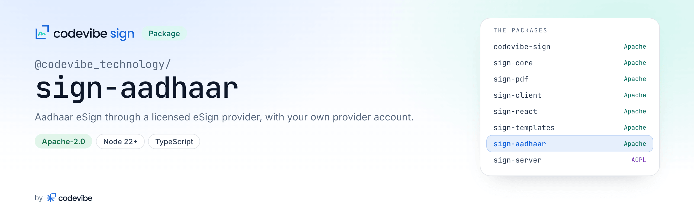
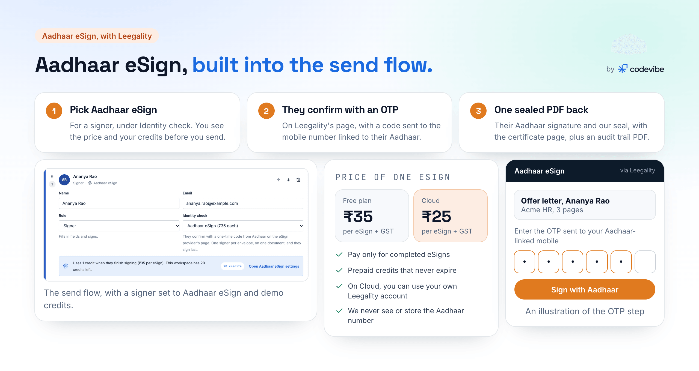

<p align="center">
  <a href="https://sign.codevibe.in?utm_source=github&utm_medium=readme&utm_campaign=sign-aadhaar&utm_content=banner"></a>
</p>

<p align="center">
  <a href="https://www.npmjs.com/package/@codevibe_technology/sign-aadhaar"></a>
  <a href="https://www.npmjs.com/package/@codevibe_technology/sign-aadhaar"></a>
  
  
  <a href="https://github.com/codevibe-technology/codevibe-sign"></a>
</p>

<p align="center">
  <a href="https://sign.codevibe.in/docs?utm_source=github&utm_medium=readme&utm_campaign=sign-aadhaar&utm_content=nav">Docs</a> ·
  <a href="https://sign.codevibe.in?utm_source=github&utm_medium=readme&utm_campaign=sign-aadhaar&utm_content=nav">Try it free</a> ·
  <a href="https://github.com/codevibe-technology/codevibe-sign#packages">All packages</a> ·
  <a href="https://github.com/codevibe-technology/codevibe-sign/blob/main/LICENSING.md">Licensing</a> ·
  <a href="https://sign.codevibe.in/docs/changelog?utm_source=github&utm_medium=readme&utm_campaign=sign-aadhaar&utm_content=nav">Changelog</a> ·
  <a href="https://github.com/codevibe-technology/codevibe-sign">GitHub</a>
</p>

# @codevibe_technology/sign-aadhaar

Aadhaar eSign for Codevibe Sign, through an eSign provider you hold an account with. It defines a
small `EsignProvider` interface and ships an adapter for [Leegality](https://www.leegality.com).

The Codevibe Sign server runs it for you: pass a provider as the server's `esign` option and
a recipient with `auth: 'aadhaar'` is sent to the provider, the callback is verified, the
signed file is kept and sealed, and the audit trail records it (see "Aadhaar eSign" in the
server README). The web app does the same from its settings. You can also call the provider
from your own backend, as shown below, and store the signed file yourself.

<p align="center">
  
</p>

## What Aadhaar eSign is

Under the Information Technology Act, 2000, an electronic record can be authenticated with an
electronic signature using a technique listed in the Second Schedule (s.3A). The Second Schedule
lists e-authentication using Aadhaar e-KYC: the signer proves who they are with an Aadhaar OTP or
biometric, and an eSign Service Provider (ESP) issues a short-lived signing certificate and signs
the document hash with it.

ESPs are Certifying Authorities licensed by the Controller of Certifying Authorities (CCA). Most
products reach them through an Application Service Provider such as Leegality, which runs the
signing page and talks to the ESP.

Use this when a law asks for a document to be "signed" in the statutory sense. For offer letters,
policies, NDAs and most business documents, the built-in electronic signature in Codevibe Sign
(IT Act s.10A, with its audit trail) is usually enough.

This is not legal advice. Ask your own counsel which documents need which kind of signature.

## You need a provider account

This package talks to the provider with the API credentials you give it, and each eSign is
billed to that account. When you run the server yourself, that is your own account with the
provider. The hosted Codevibe Sign app can also sign through Codevibe's account with prepaid
credits.

## Install

```sh
pnpm add @codevibe_technology/sign-aadhaar @codevibe_technology/sign-core
```

Node 22 or later. The package uses `fetch` and `node:crypto`.

## How the flow works

1. Your server calls `createRequest` with the PDF and the signer. The provider returns a
   `providerRef` and a `signUrl`.
2. You send the signer to `signUrl`. They review the document and sign with Aadhaar OTP on the
   provider's page.
3. The provider calls your webhook. `parseWebhook` verifies it and returns
   `{ providerRef, status }`, where `status` is `signed`, `declined`, `expired` or `failed`.
4. When the status is `signed`, `fetchSignedDocument(providerRef)` returns the signed PDF. Store it
   and record the event in the envelope's audit trail.

The signed PDF carries the provider's digital signature. Do not draw on it or add pages to it
afterwards: any change other than another signature breaks that signature. To seal it, use
`countersign` from `@codevibe_technology/sign-pdf`.

## Usage

<!-- check:
import type { Envelope } from '@codevibe_technology/sign-core';
declare const envelope: Envelope;
declare const pdf: Uint8Array;
declare const request: { headers: Headers };
declare const rawBody: string;
-->

```ts check
import { createLeegalityProvider } from '@codevibe_technology/sign-aadhaar';

const esign = createLeegalityProvider({
  environment: 'sandbox',
  authToken: process.env.LEEGALITY_API_KEY!,
  privateSalt: process.env.LEEGALITY_PRIVATE_SALT!,
  profileId: process.env.LEEGALITY_WORKFLOW_ID!,
});

const { providerRef, signUrl } = await esign.createRequest({
  envelopeId: envelope.id,
  recipient: { name: 'Asha Rao', email: 'asha@example.com' },
  documentBytes: pdf,
  documentName: 'Appointment letter.pdf',
  signaturePositions: [{ page: 0, rect: { x: 72, y: 640, width: 160, height: 48 } }],
  callbackUrl: 'https://sign.example.com/hooks/leegality',
  redirectUrl: 'https://sign.example.com/done',
});

// In your webhook route, pass the raw body exactly as received.
const event = await esign.parseWebhook(request.headers, rawBody);
if (event?.status === 'signed') {
  const signed = await esign.fetchSignedDocument(event.providerRef);
}
```

## API

| Export                    | What it is                                                                                                                                  |
| ------------------------- | ------------------------------------------------------------------------------------------------------------------------------------------- |
| `EsignProvider`           | `createRequest`, `parseWebhook`, `fetchSignedDocument`, and optionally `webhookRef` and `checkCredentials`. Implement it to add a provider. |
| `EsignRequest`            | `envelopeId`, `reference`, `recipient`, `documentBytes`, `documentName`, `signaturePositions`, `callbackUrl`, `redirectUrl`.                |
| `EsignEvent`              | `{ providerRef, status, signerName?, signedAt? }`.                                                                                          |
| `createLeegalityProvider` | The Leegality adapter. Options below.                                                                                                       |
| `computeLeegalityMac`     | The webhook `mac` for a document id, for tests and tooling.                                                                                 |
| `leegalityWebhookRef`     | The document id a Leegality webhook body names, read without verifying it.                                                                  |

`reference` is your own id for one request, sent to Leegality as the `irn`; it defaults to
`envelopeId`. Give each attempt its own when a signer can start again.

`webhookRef(rawBody)` reads the provider reference from a callback without checking anything.
A server that holds several provider accounts uses it to find whose credentials must verify
the callback; never act on it before `parseWebhook` has accepted the same body.

`checkCredentials()` makes one read-only call and resolves when the provider accepts the
credentials. The Leegality adapter asks for the status of a document id that cannot exist:
an account Leegality recognises is told there is no such document, and any other answer
throws `SignError('PROVIDER_ERROR')`.

`parseWebhook` throws `SignError('WEBHOOK_INVALID')` for any body it cannot verify, and returns
`null` for a verified callback that does not change the signer's status (such as a reviewer
approval). Provider failures throw `SignError('PROVIDER_ERROR')` with `details.reason`
(`timeout`, `network`, `unauthorized`, `unavailable`, `rejected`, `not_found`, ...) and
`details.retryable`; HTTP 429 throws `RATE_LIMITED`. Errors never contain the document or your
credentials, and the package does not log.

Limits: webhook bodies over 256 KB are refused before parsing, provider JSON responses over 2 MB
and signed files over `maxSignedDocumentBytes` are cut off while streaming, and a signing link
that is not https is treated as missing. Webhooks are not replay-protected by Leegality, so make
your handler idempotent on `(providerRef, status)`.

### Leegality options

| Option                   | Required | Notes                                                                                               |
| ------------------------ | -------- | --------------------------------------------------------------------------------------------------- |
| `environment`            | yes      | `sandbox` (`https://sandbox.leegality.com/api`) or `production` (`https://app1.leegality.com/api`). |
| `authToken`              | yes      | Dashboard, API Settings. Sent as `X-Auth-Token`.                                                    |
| `privateSalt`            | yes      | Dashboard, API Settings. Verifies webhook `mac`.                                                    |
| `profileId`              | yes      | The Workflow ID, or a function `(request) => workflowId`.                                           |
| `confirmWebhooks`        | no       | Default `true`. Confirms each webhook with the Check transaction status API.                        |
| `webhookHeader`          | no       | `{ name, value }` of a static header Leegality support adds to your webhooks.                       |
| `timeoutMs`              | no       | Default 30 000, covering the response body as well. Whole milliseconds, at most 10 minutes.         |
| `maxSignedDocumentBytes` | no       | Default 50 MB.                                                                                      |
| `baseUrl`, `fetch`       | no       | Overrides for proxies and tests. `baseUrl` must be https (plain http only for localhost).           |

### Set up the Leegality workflow

Leegality's API runs a published Workflow; several settings live only in that workflow, not in the
API request. In the Leegality dashboard, for the workflow you pass as `profileId`:

- choose Aadhaar eSign as the signature type for the invitee;
- place the signature box (if you need different layouts, create a workflow per layout and pass
  `profileId` as a function);
- under the invitee's custom URLs and webhooks, set the Webhook and Error Webhook to your
  `callbackUrl`, choose webhook version 2.5, and set the Redirect URL to your `redirectUrl`.

### What Leegality's public documentation does not cover

The adapter only does what Leegality's published API reference confirms. These gaps are handled
by configuration rather than guessed:

- **Signature positions, callback URL and redirect URL** are not fields of the Create eSigning
  request API. They come from the workflow (see above), so `signaturePositions`, `callbackUrl`
  and `redirectUrl` are not sent.
- **Choosing Aadhaar per request** is not documented; the workflow decides the eSign type.
- **Webhook authenticity**: the documented `mac` is HMAC-SHA1 of the `documentId` only, keyed by
  the Private Salt. The rest of the body is not covered, and no timestamp or replay protection
  is documented. That is why `confirmWebhooks` is on by default. The hex encoding is taken from
  the documented examples.
- **Signing time**: no webhook or status field gives the time of signing, so `signedAt` is not
  set. Record the time you received the verified event instead.
- **HTTP status codes**: the reference says errors usually come back as HTTP 200 with
  `status: 0`. Other status codes and rate limits ("fair use limits may apply") are not
  specified, so they are mapped generically.
- **Response `status` on success**: the published sample shows `status: 0` beside a success
  message, so a returned `documentId` is treated as success.
- **Webhook versions** other than 2.5 are not documented in the API reference.

## Roadmap

eMudhra as a second provider is planned. The `EsignProvider` interface is what it will
implement, so nothing in your code changes when you switch.

## Docs

Guides and the full API reference are at [sign.codevibe.in](https://sign.codevibe.in?utm_source=github&utm_medium=readme&utm_campaign=sign-aadhaar&utm_content=body).

## Licence

Apache-2.0 © Codevibe

---

### The Codevibe Sign packages

| Package                                                                                                    | What it does                                                                                        | Licence    |
| ---------------------------------------------------------------------------------------------------------- | --------------------------------------------------------------------------------------------------- | ---------- |
| [`codevibe-sign`](https://www.npmjs.com/package/codevibe-sign)                                             | The one library to install: API client, PDF tools, core rules, React components and a command line. | Apache-2.0 |
| [`@codevibe_technology/sign-core`](https://www.npmjs.com/package/@codevibe_technology/sign-core)           | Envelopes, routing, reminders, expiry and a hash-chained audit log. No I/O.                         | Apache-2.0 |
| [`@codevibe_technology/sign-pdf`](https://www.npmjs.com/package/@codevibe_technology/sign-pdf)             | Draws fields, appends the certificate page, seals with PAdES and verifies the seal.                 | Apache-2.0 |
| [`@codevibe_technology/sign-client`](https://www.npmjs.com/package/@codevibe_technology/sign-client)       | Typed client for the HTTP API, signing sessions and webhook checks. No dependencies.                | Apache-2.0 |
| [`@codevibe_technology/sign-react`](https://www.npmjs.com/package/@codevibe_technology/sign-react)         | Signature pad, signing view and field placer for your own React app.                                | Apache-2.0 |
| [`@codevibe_technology/sign-templates`](https://www.npmjs.com/package/@codevibe_technology/sign-templates) | Templates with roles and prefilled fields, and bulk send from CSV.                                  | Apache-2.0 |
| [`@codevibe_technology/sign-aadhaar`](https://www.npmjs.com/package/@codevibe_technology/sign-aadhaar)     | Aadhaar eSign through a licensed eSign provider (Leegality). Used by the server and the web app.    | Apache-2.0 |
| [`@codevibe_technology/sign-server`](https://www.npmjs.com/package/@codevibe_technology/sign-server)       | The HTTP API and runtime: storage, mail, one-time codes, webhooks and sealing.                      | AGPL-3.0   |

The web app, the Docker image and the docs live in the [Codevibe Sign repository](https://github.com/codevibe-technology/codevibe-sign). Try it free at [sign.codevibe.in](https://sign.codevibe.in?utm_source=github&utm_medium=readme&utm_campaign=sign-aadhaar&utm_content=footer), or self-host it with no limits.

<p align="center">
  <a href="https://codevibe.in?utm_source=github&utm_medium=readme&utm_campaign=sign-aadhaar&utm_content=footer-logo">
    <picture>
      <source media="(prefers-color-scheme: dark)" srcset="https://raw.githubusercontent.com/codevibe-technology/codevibe-sign/main/.github/assets/codevibe-logo-light.png">
      
    </picture>
  </a>
</p>

<p align="center">
  Built and maintained by <a href="https://codevibe.in?utm_source=github&utm_medium=readme&utm_campaign=sign-aadhaar&utm_content=built-by"><b>Codevibe</b></a>, a software development agency in Gurugram, India.<br>
  <a href="https://sign.codevibe.in?utm_source=github&utm_medium=readme&utm_campaign=sign-aadhaar&utm_content=footer-links">Codevibe Sign</a> · <a href="https://sign.codevibe.in/docs?utm_source=github&utm_medium=readme&utm_campaign=sign-aadhaar&utm_content=footer-links">Docs</a> · <a href="https://codevibe.in/tools/codevibe-sign?utm_source=github&utm_medium=readme&utm_campaign=sign-aadhaar&utm_content=footer-links">Product page</a> · <a href="mailto:hello@codevibe.in">hello@codevibe.in</a>
</p>
