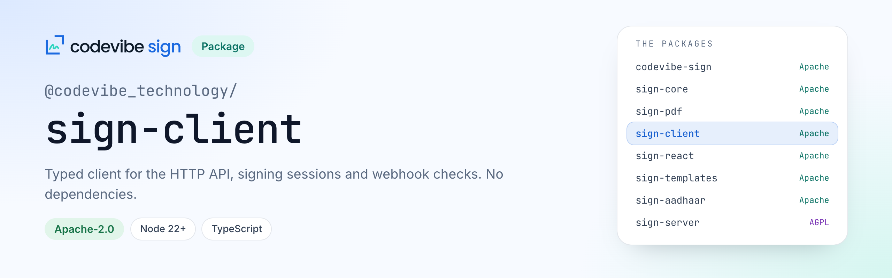

<p align="center">
  <a href="https://sign.codevibe.in?utm_source=github&utm_medium=readme&utm_campaign=sign-client&utm_content=banner"></a>
</p>

<p align="center">
  <a href="https://www.npmjs.com/package/@codevibe_technology/sign-client"></a>
  <a href="https://www.npmjs.com/package/@codevibe_technology/sign-client"></a>
  
  
  <a href="https://github.com/codevibe-technology/codevibe-sign"></a>
</p>

<p align="center">
  <a href="https://sign.codevibe.in/docs?utm_source=github&utm_medium=readme&utm_campaign=sign-client&utm_content=nav">Docs</a> ·
  <a href="https://sign.codevibe.in?utm_source=github&utm_medium=readme&utm_campaign=sign-client&utm_content=nav">Try it free</a> ·
  <a href="https://github.com/codevibe-technology/codevibe-sign#packages">All packages</a> ·
  <a href="https://github.com/codevibe-technology/codevibe-sign/blob/main/LICENSING.md">Licensing</a> ·
  <a href="https://sign.codevibe.in/docs/changelog?utm_source=github&utm_medium=readme&utm_campaign=sign-client&utm_content=nav">Changelog</a> ·
  <a href="https://github.com/codevibe-technology/codevibe-sign">GitHub</a>
</p>

# @codevibe_technology/sign-client

A typed client for the Codevibe Sign HTTP API. One part sends envelopes from your server,
one part drives a signing session in the browser, and a helper checks webhook signatures.

No runtime dependencies. It uses the global `fetch` and Web Crypto, so it runs in Node 22+,
browsers, Deno, Bun and edge runtimes. Pass your own `fetch` to route requests anywhere,
including straight into an in-process server.

## Install

```sh
pnpm add @codevibe_technology/sign-client
```

## Sending

```ts
import { readFile } from 'node:fs/promises';
import { createSignClient } from '@codevibe_technology/sign-client';

const sign = createSignClient({
  baseUrl: 'https://sign.example.com',
  apiKey: process.env.SIGN_API_KEY!,
});

const envelope = await sign.envelopes.create({
  title: 'Offer letter',
  send: true,
  documents: [{ key: 'offer', name: 'offer.pdf', content: await readFile('offer.pdf') }],
  recipients: [{ key: 'asha', name: 'Asha Rao', email: 'asha@example.com', auth: 'email_otp' }],
  fields: [
    { recipient: 'asha', type: 'signature', page: 0, x: 72, y: 640, width: 180, height: 48 },
  ],
  metadata: { employeeId: 'E-104' },
});

// Later, once the `envelope.completed` webhook arrives:
const pdf = await sign.envelopes.downloadDocument(envelope.id, envelope.documents[0]!.id, {
  version: 'sealed',
});
```

Field boxes are in PDF points from the top-left corner of the page. Documents can be a
`Uint8Array` (a Node `Buffer` is one), an `ArrayBuffer` or a `Blob`.

## Templates

Store the PDFs, roles and fields once, then make an envelope by saying who takes each role:

```ts
const template = await sign.templates.create({
  name: 'Offer letter',
  documents: [{ name: 'offer.pdf', content: pdfBytes }],
  roles: [{ key: 'employee', name: 'Employee' }],
  fields: [
    { role: 'employee', type: 'signature', page: 0, x: 72, y: 640, width: 180, height: 48 },
    {
      role: 'employee',
      type: 'text',
      label: 'Employee code',
      page: 0,
      x: 72,
      y: 600,
      width: 180,
      height: 20,
    },
  ],
});

const envelope = await sign.templates.createEnvelope(template.id, {
  roles: { Employee: { name: 'Asha Rao', email: 'asha@example.com' } },
  prefill: { 'Employee code': 'E-1042' },
  send: true,
});
```

## Verifying a sealed PDF

The verify routes are public, so this needs no API key:

```ts
import { createVerifyClient } from '@codevibe_technology/sign-client';

const verify = createVerifyClient({ baseUrl: 'https://sign.example.com' });
const result = await verify.pdf(sealedBytes); // or verify.sha256(hex)
if (result.valid) console.log(result.envelope?.title, result.signedAt);
else console.log(result.reason); // for example not_whole_document
```

## Signing

In the browser, with the token from the signing link:

```ts
import { createSignerClient } from '@codevibe_technology/sign-client';

const signer = createSignerClient({ baseUrl: 'https://sign.example.com', token });
let session = await signer.session();
if (session.otpRequired && !session.authenticated) {
  await signer.requestOtp();
  await signer.verifyOtp(codeTypedByTheSigner);
  // Documents and fields are only listed once the code has been checked.
  session = await signer.session();
}
const pdf = await signer.document(session.documents[0]!.id);
await signer.view();
await signer.submit(values); // [{ fieldId, value }]
```

When the signing link goes through the server's `GET /sign/:token`, the server keeps the
token in an HttpOnly cookie and opens your page without it. Pass `token: 'link'` and serve the
page from the same origin as the API, and the cookie stands in for the token.

After `verifyOtp` the client sends the session in the `X-Sign-Session` header on every
later call. Read `signer.sessionToken` and pass it back as `sessionToken` to resume after a
page reload. `submit` sends `consent: true`: call it only after the signer has agreed.

## Webhooks

```ts
import { readWebhook } from '@codevibe_technology/sign-client';

const delivery = await readWebhook(secret, req.headers['x-codevibe-signature'], rawBody);
if (delivery.type === 'envelope.completed') {
  // delivery.data.envelope.id, .metadata, .recipients
}
```

Pass the body exactly as received. `verifyWebhook(secret, header, rawBody, { toleranceSeconds })`
returns a boolean instead of throwing. Signatures older than five minutes are rejected.

## Errors, retries and idempotency

Every failure is a `SignApiError` with the server's `code` (such as `VALIDATION`,
`INVALID_STATE` or `OTP_INVALID`), the HTTP `status`, `details`, and `requestId` when an
`X-Request-Id` header came back. Validation problems are listed in `err.issues` as
`{ path, message }`. When no response arrived, `status` is 0 and `code` is `NETWORK`,
`TIMEOUT` or `ABORTED`.

Every POST carries an `Idempotency-Key`, generated unless you pass `idempotencyKey`, and the
server answers a repeat with the first response. That makes POSTs and GETs safe to retry:
they are retried on network errors, timeouts, 429 and 5xx, with exponential backoff and
`Retry-After` respected. PATCH (`update`) and DELETE are never retried.

## API

| Call                                                                     | Returns                        |
| ------------------------------------------------------------------------ | ------------------------------ |
| `createSignClient({ baseUrl, apiKey, fetch?, timeoutMs?, retries? })`    | `SignClient`                   |
| `envelopes.create(input, options?)`                                      | `Envelope`                     |
| `envelopes.get(id)`, `update(id, patch)`, `send(id)`, `void(id, reason)` | `Envelope`                     |
| `envelopes.shareLink(id, recipientId)`                                   | `{ recipientId, url }`         |
| `envelopes.correctRecipient(id, recipientId, { name?, email?, phone? })` | `Envelope`                     |
| `envelopes.recall(id, note?)`                                            | `{ draft, recalled }`          |
| `envelopes.revise(id)`                                                   | `{ draft, declined }`          |
| `envelopes.events(id)`                                                   | `{ events, chainValid }`       |
| `envelopes.downloadDocument(id, documentId, { version? })`               | `Uint8Array`                   |
| `envelopes.certificate(id)`                                              | `Certificate`                  |
| `templates.list({ q?, limit?, cursor? })`                                | `{ templates, nextCursor }`    |
| `templates.create(input)`, `get(id)`, `update(id, patch)`                | `Template`                     |
| `templates.delete(id)`                                                   | `void`                         |
| `templates.createEnvelope(id, { roles, prefill?, send? })`               | `Envelope`                     |
| `verify.pdf(content)`, `verify.sha256(hash)`                             | `PublicVerification`           |
| `createVerifyClient({ baseUrl, fetch? })`                                | `VerifyClient` (no API key)    |
| `createSignerClient({ baseUrl, token, sessionToken?, fetch? })`          | `SignerClient`                 |
| `session()`, `document(id)`                                              | `SigningSession`, `Uint8Array` |
| `requestOtp()`, `verifyOtp(code)`                                        | `OtpSent`, `OtpSession`        |
| `view()`, `submit(values)`, `decline(reason)`                            | `SignerActionResult`           |
| `verifyWebhook(secret, header, rawBody, options?)`                       | `Promise<boolean>`             |
| `readWebhook(secret, header, rawBody, options?)`                         | `WebhookDelivery`              |

Client options: `timeoutMs` per attempt (default 30 000), `retries` (default 2),
`retryDelayMs` backoff base (default 500). Every call takes `{ signal, idempotencyKey }`.

The domain types (`Envelope`, `Recipient`, `Field`, `FieldValue`, `AuditEvent` and the rest)
are those of `@codevibe_technology/sign-core`, re-exported here so you need only this package.

## Docs

Guides and the full API reference are at [sign.codevibe.in](https://sign.codevibe.in?utm_source=github&utm_medium=readme&utm_campaign=sign-client&utm_content=body).

## Licence

Apache-2.0 © Codevibe

---

### The Codevibe Sign packages

| Package                                                                                                    | What it does                                                                                        | Licence    |
| ---------------------------------------------------------------------------------------------------------- | --------------------------------------------------------------------------------------------------- | ---------- |
| [`codevibe-sign`](https://www.npmjs.com/package/codevibe-sign)                                             | The one library to install: API client, PDF tools, core rules, React components and a command line. | Apache-2.0 |
| [`@codevibe_technology/sign-core`](https://www.npmjs.com/package/@codevibe_technology/sign-core)           | Envelopes, routing, reminders, expiry and a hash-chained audit log. No I/O.                         | Apache-2.0 |
| [`@codevibe_technology/sign-pdf`](https://www.npmjs.com/package/@codevibe_technology/sign-pdf)             | Draws fields, appends the certificate page, seals with PAdES and verifies the seal.                 | Apache-2.0 |
| [`@codevibe_technology/sign-client`](https://www.npmjs.com/package/@codevibe_technology/sign-client)       | Typed client for the HTTP API, signing sessions and webhook checks. No dependencies.                | Apache-2.0 |
| [`@codevibe_technology/sign-react`](https://www.npmjs.com/package/@codevibe_technology/sign-react)         | Signature pad, signing view and field placer for your own React app.                                | Apache-2.0 |
| [`@codevibe_technology/sign-templates`](https://www.npmjs.com/package/@codevibe_technology/sign-templates) | Templates with roles and prefilled fields, and bulk send from CSV.                                  | Apache-2.0 |
| [`@codevibe_technology/sign-aadhaar`](https://www.npmjs.com/package/@codevibe_technology/sign-aadhaar)     | Aadhaar eSign through a licensed eSign provider, with your own account. Standalone for now.         | Apache-2.0 |
| [`@codevibe_technology/sign-server`](https://www.npmjs.com/package/@codevibe_technology/sign-server)       | The HTTP API and runtime: storage, mail, one-time codes, webhooks and sealing.                      | AGPL-3.0   |

The web app, the Docker image and the docs live in the [Codevibe Sign repository](https://github.com/codevibe-technology/codevibe-sign). Try it free at [sign.codevibe.in](https://sign.codevibe.in?utm_source=github&utm_medium=readme&utm_campaign=sign-client&utm_content=footer), or self-host it with no limits.

<p align="center">
  <a href="https://codevibe.in?utm_source=github&utm_medium=readme&utm_campaign=sign-client&utm_content=footer-logo">
    <picture>
      <source media="(prefers-color-scheme: dark)" srcset="https://raw.githubusercontent.com/codevibe-technology/codevibe-sign/main/.github/assets/codevibe-logo-light.png">
      
    </picture>
  </a>
</p>

<p align="center">
  Built and maintained by <a href="https://codevibe.in?utm_source=github&utm_medium=readme&utm_campaign=sign-client&utm_content=built-by"><b>Codevibe</b></a>, a software development agency in Gurugram, India.<br>
  <a href="https://sign.codevibe.in?utm_source=github&utm_medium=readme&utm_campaign=sign-client&utm_content=footer-links">Codevibe Sign</a> · <a href="https://sign.codevibe.in/docs?utm_source=github&utm_medium=readme&utm_campaign=sign-client&utm_content=footer-links">Docs</a> · <a href="https://codevibe.in/tools/codevibe-sign?utm_source=github&utm_medium=readme&utm_campaign=sign-client&utm_content=footer-links">Product page</a> · <a href="mailto:hello@codevibe.in">hello@codevibe.in</a>
</p>
