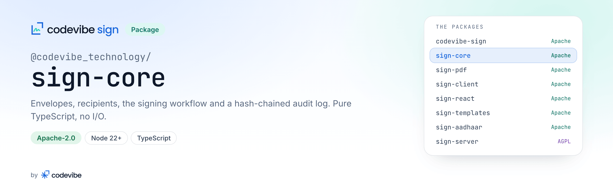

<p align="center">
  <a href="https://sign.codevibe.in?utm_source=github&utm_medium=readme&utm_campaign=sign-core&utm_content=banner"></a>
</p>

<p align="center">
  <a href="https://www.npmjs.com/package/@codevibe_technology/sign-core"></a>
  <a href="https://www.npmjs.com/package/@codevibe_technology/sign-core"></a>
  
  
  <a href="https://github.com/codevibe-technology/codevibe-sign"></a>
</p>

<p align="center">
  <a href="https://sign.codevibe.in/docs?utm_source=github&utm_medium=readme&utm_campaign=sign-core&utm_content=nav">Docs</a> ·
  <a href="https://sign.codevibe.in?utm_source=github&utm_medium=readme&utm_campaign=sign-core&utm_content=nav">Try it free</a> ·
  <a href="https://github.com/codevibe-technology/codevibe-sign#packages">All packages</a> ·
  <a href="https://github.com/codevibe-technology/codevibe-sign/blob/main/LICENSING.md">Licensing</a> ·
  <a href="https://sign.codevibe.in/docs/changelog?utm_source=github&utm_medium=readme&utm_campaign=sign-core&utm_content=nav">Changelog</a> ·
  <a href="https://github.com/codevibe-technology/codevibe-sign">GitHub</a>
</p>

# @codevibe_technology/sign-core

The domain model and rules behind Codevibe Sign: envelopes, recipients and fields, the
signing workflow, reminders and expiry, a hash-chained audit log, signing tokens and OTPs.

It is plain TypeScript with no runtime dependencies and no I/O. Every workflow step is a
pure function that returns the new envelope, the audit events to append and the effects
(emails, webhooks, sealing) for you to perform. Time, ids, randomness and hashing are
passed in, so the same code runs in Node, in the browser and in tests.

## Install

```sh
pnpm add @codevibe_technology/sign-core
```

Node 22 or later, or any runtime with Web Crypto.

## Usage

<!-- check:
declare const sha256: string;
declare const pageSizes: { width: number; height: number }[];
declare const storedEventCount: number;
declare const store: { save(envelope: unknown, events: unknown[]): Promise<void> };
declare function perform(effect: unknown): Promise<void>;
declare const fieldId: string;
declare const pngBase64: string;
declare const ip: string;
declare const userAgent: string;
-->

```ts check
import {
  addDocument,
  addField,
  addRecipient,
  commitTransition,
  createEnvelope,
  randomIds,
  send,
  submit,
  systemClock,
  webCryptoHasher,
} from '@codevibe_technology/sign-core';

const deps = { clock: systemClock, ids: randomIds };

let { envelope } = createEnvelope({ title: 'Offer letter', routing: 'sequential' }, deps);

const doc = addDocument(
  envelope,
  { name: 'offer.pdf', sha256, pageCount: 2, fileKey: 'files/offer.pdf', pageSizes },
  deps,
);
const asha = addRecipient(doc.envelope, { name: 'Asha Rao', email: 'asha@example.com' }, deps);
envelope = addField(
  asha.envelope,
  {
    documentId: doc.document.id,
    recipientId: asha.recipient.id,
    type: 'signature',
    page: 1,
    rect: { x: 72, y: 640, width: 180, height: 48 },
  },
  deps,
).envelope;

const result = send(envelope, deps);
// Chain the events after the current head, then save envelope and events together.
const committed = await commitTransition(result, storedEventCount + 1, webCryptoHasher);
await store.save(committed.envelope, committed.events);
for (const effect of committed.effects) await perform(effect); // invites, webhooks

// Later, when Asha submits the signing form:
const signed = submit(
  committed.envelope,
  {
    recipientId: asha.recipient.id,
    values: [{ fieldId, value: pngBase64 }],
    context: { ip, userAgent },
  },
  deps,
);
```

Rejected actions throw a `SignError` with a stable `code` (`NOT_YOUR_TURN`,
`ENVELOPE_EXPIRED`, `REQUIRED_FIELDS_MISSING`, ...). Validation errors use `VALIDATION`
and list every problem in `details.issues` as `{ path, message }`, where `path` names the
field to fix, for example `recipients.r1.email`.

## API

### Building a draft

Edits are allowed only while the envelope is a `draft`.

| Function                                                             | Notes                                                                    |
| -------------------------------------------------------------------- | ------------------------------------------------------------------------ |
| `createEnvelope(input, { clock, ids })` → `TransitionResult`         | Starts a draft; emits `envelope.created`.                                |
| `updateEnvelope(envelope, patch, { clock })` → `Envelope`            | Title, message, routing, reminders, expiry, metadata.                    |
| `addDocument(envelope, input, { ids })` → `{ envelope, document }`   | `pageSizes` (PDF points) enables bounds checks for fields.               |
| `removeDocument(envelope, documentId)` → `Envelope`                  | Also removes its fields.                                                 |
| `addRecipient(envelope, input, { ids })` → `{ envelope, recipient }` | Defaults: `signer`, next order, `email_otp` (or `sms_otp` with a phone). |
| `updateRecipient(envelope, recipientId, patch)` → `Envelope`         |                                                                          |
| `removeRecipient(envelope, recipientId)` → `Envelope`                | Also removes their fields.                                               |
| `addField(envelope, input, { ids })` → `{ envelope, field }`         | Signers and approvers only; box must sit inside the page.                |
| `moveField(envelope, fieldId, { rect, page?, documentId? })`         |                                                                          |
| `removeField(envelope, fieldId)` → `Envelope`                        |                                                                          |
| `prefillFields(envelope, values)` → `Envelope`                       | Sender's values for text, name and checkbox fields; empty clears.        |
| `validateForSend(envelope, now)` → `ValidationIssue[]`               | Empty means ready. Every signer needs a required signature field.        |

#### Recording draft edits

The edits above return just the envelope, so existing callers keep working. Each has a
`...WithEvents` twin that takes `{ clock }` (plus `ids` where it creates something) and an
optional `{ context }`, and returns a `TransitionResult` with one `envelope.updated` event
to commit like any other. Created items are returned alongside, for example
`addRecipientWithEvents(...)` → `{ envelope, events, effects, recipient }`.

`updateEnvelopeWithEvents`, `addDocumentWithEvents`, `removeDocumentWithEvents`,
`addRecipientWithEvents`, `updateRecipientWithEvents`, `removeRecipientWithEvents`,
`addFieldWithEvents`, `moveFieldWithEvents`, `removeFieldWithEvents`,
`prefillFieldsWithEvents`.

The event's `data.change` names the edit (`DraftChange`: `details.updated`,
`document.added`, `recipient.removed`, `values.prefilled`, ...) with the ids involved;
recipient and field edits set `recipientId`. Changed keys are listed, never their values,
so contact details and prefilled data stay out of the log. An edit that changes nothing
returns no event. Draft edits produce no effects.

### Workflow

All take `{ clock }` and return `TransitionResult` (`{ envelope, events, effects }`).

| Function                                                      | Notes                                                           |
| ------------------------------------------------------------- | --------------------------------------------------------------- |
| `send(envelope, deps, { context? })`                          | Invites whoever may act first.                                  |
| `markViewed(envelope, { recipientId, context? }, deps)`       |                                                                 |
| `markAuthenticated(envelope, { recipientId, method? }, deps)` | Call after the OTP or other check succeeds.                     |
| `submit(envelope, { recipientId, values, context? }, deps)`   | Signers sign, approvers approve. Completes when all have acted. |
| `decline(envelope, { recipientId, reason, context? }, deps)`  | Stops the envelope for everyone.                                |
| `voidEnvelope(envelope, { reason, context? }, deps)`          | Sender withdraws it.                                            |
| `remind(envelope, { recipientId?, context? }, deps)`          | Sender nudges whoever's turn it is, at most every 15 minutes.   |
| `tick(envelope, now)`                                         | Sends due reminders or expires the envelope. Idempotent.        |
| `recordSeal(envelope, { documentId, sha256 }, deps)`          | Logs `document.sealed` after the server seals a file.           |

Helpers: `currentRecipients(envelope)`, `isFinal(envelopeOrStatus)`, `isActive`,
`hasActed`, `isExpiredAt`, `nextReminderAt`, and `nextTickAt(envelope)`, the next moment
`tick` has work to do, for scheduling.

In `sequential` routing the unfinished signers and approvers with the lowest `order` act
first, and equal orders act together. In `parallel` routing everyone acts at once.
Viewers never act; they receive the completed copy.

Submitted values are checked against the field type: signatures and initials must be
real PNGs (base64 or a `data:image/png;base64,` URL) of at most 512 KB and 2048 x 2048
pixels (`MAX_IMAGE_BYTES`, `MAX_IMAGE_DIMENSION`), dates ISO,
checkboxes `'true'` or `'false'`, text at most 1000 characters. Name fields are filled
in with the recipient's name when left empty. Date-signed fields always get the server's
time of signing as a full ISO date-time in UTC; a date the signer sends is ignored, so a
signature cannot be back-dated. Render it in the signer's time zone if you like: the
certificate page shows the exact UTC time from the audit log.

An `aadhaar` field marks where a signer with `auth: 'aadhaar'` signs at the eSign provider.
It takes no value. `validateForSend` wants exactly one, required, for that signer, no
signature or initials fields for them, and none for anyone else; `adoptAadhaarBox(envelope)`
turns the lone signature field of such a signer, as older clients sent it, into the box.

Values the sender prefilled count towards required fields, so the signer does not have to
send them again. A field added with `readOnly: true` keeps the sender's value: `submit`
refuses a different value for it with `FIELD_NOT_YOURS` (`details.readOnly` is `true`),
and `validateForSend` asks for a value on every required read-only field. Only text, name
and checkbox fields (`PREFILLABLE_FIELD_TYPES`) can be prefilled or read-only.

### Validators

The checks the builder uses are exported for packages that validate their own input
first, such as templates. Each returns `ValidationIssue[]` (empty means fine) and copes with
malformed input:

- `rectIssues(rect, pageSize | undefined, path)`: finite, positive, inside the page.
- `pageSizeIssues(sizes, pageCount, path)`: one positive size per page.
- `reminderIssues(policy, path?)`: whole days, and a gap when more than one reminder.
- `validationError(issues)` → `SignError` with code `VALIDATION`.

### Audit log

`hash = sha256(prevHash + canonicalize(event))`, starting from `GENESIS_HASH` (64 zeros).

- `canonicalize(event)`: JSON with sorted keys, without `prevHash` and `hash`.
- `appendEvents(prevHead, seqStart, events, hasher)` → `Promise<AuditEvent[]>`
- `commitTransition(result, nextSeq, hasher)`: chains a transition's events and sets
  `envelope.auditHead`.
- `verifyChain(events, hasher, { expectedHead?, envelopeId? })` → `{ valid: true, head }`
  or `{ valid: false, brokenAt, reason }`. Pass `expectedHead` (`envelope.auditHead`) to
  catch events cut off the end, and `envelopeId` to check that every event belongs to the
  envelope you are verifying (`reason: 'envelope'`). Without `envelopeId` the events only
  have to agree with each other, so a whole log copied from another envelope would pass.

### Tokens and OTPs

- `createSigningToken(random)` → `{ token, tokenHash }`: 32 random bytes, base64url.
  Store only the hash. `hashToken(token)` and `verifyToken(token, hash)`; `verifyToken`
  refuses anything not shaped like an issued token before hashing it, and
  `isSigningTokenShape(value)` runs that shape check alone (43 base64url characters).
- `createOtp(random, clock)` → `{ code, codeHash, expiresAt, state }`: 6 digits, valid
  for 10 minutes, salted hash. Store `state`, send `code`.
- `verifyOtp(state, code, clock)` → `{ ok, state, ... }`. Persist the returned state on
  every call. Failures carry `OTP_INVALID`, `OTP_EXPIRED` or `OTP_LOCKED` (after 5 wrong
  attempts) and a ready `SignError`. Comparisons are constant time.

### Defaults

`webCryptoHasher`, `systemClock`, `randomIds` and `cryptoRandom` implement the
`Hasher`, `Clock`, `IdGenerator` and `RandomSource` ports with Web Crypto.

## Docs

Guides and the full API reference are at [sign.codevibe.in](https://sign.codevibe.in?utm_source=github&utm_medium=readme&utm_campaign=sign-core&utm_content=body).

## Licence

Apache-2.0 © Codevibe

---

### The Codevibe Sign packages

| Package                                                                                                    | What it does                                                                                        | Licence    |
| ---------------------------------------------------------------------------------------------------------- | --------------------------------------------------------------------------------------------------- | ---------- |
| [`codevibe-sign`](https://www.npmjs.com/package/codevibe-sign)                                             | The one library to install: API client, PDF tools, core rules, React components and a command line. | Apache-2.0 |
| [`@codevibe_technology/sign-core`](https://www.npmjs.com/package/@codevibe_technology/sign-core)           | Envelopes, routing, reminders, expiry and a hash-chained audit log. No I/O.                         | Apache-2.0 |
| [`@codevibe_technology/sign-pdf`](https://www.npmjs.com/package/@codevibe_technology/sign-pdf)             | Draws fields, appends the certificate page, seals with PAdES and verifies the seal.                 | Apache-2.0 |
| [`@codevibe_technology/sign-client`](https://www.npmjs.com/package/@codevibe_technology/sign-client)       | Typed client for the HTTP API, signing sessions and webhook checks. No dependencies.                | Apache-2.0 |
| [`@codevibe_technology/sign-react`](https://www.npmjs.com/package/@codevibe_technology/sign-react)         | Signature pad, signing view and field placer for your own React app.                                | Apache-2.0 |
| [`@codevibe_technology/sign-templates`](https://www.npmjs.com/package/@codevibe_technology/sign-templates) | Templates with roles and prefilled fields, and bulk send from CSV.                                  | Apache-2.0 |
| [`@codevibe_technology/sign-aadhaar`](https://www.npmjs.com/package/@codevibe_technology/sign-aadhaar)     | Aadhaar eSign through a licensed eSign provider (Leegality). Used by the server and the web app.    | Apache-2.0 |
| [`@codevibe_technology/sign-server`](https://www.npmjs.com/package/@codevibe_technology/sign-server)       | The HTTP API and runtime: storage, mail, one-time codes, webhooks and sealing.                      | AGPL-3.0   |

The web app, the Docker image and the docs live in the [Codevibe Sign repository](https://github.com/codevibe-technology/codevibe-sign). Try it free at [sign.codevibe.in](https://sign.codevibe.in?utm_source=github&utm_medium=readme&utm_campaign=sign-core&utm_content=footer), or self-host it with no limits.

<p align="center">
  <a href="https://codevibe.in?utm_source=github&utm_medium=readme&utm_campaign=sign-core&utm_content=footer-logo">
    <picture>
      <source media="(prefers-color-scheme: dark)" srcset="https://raw.githubusercontent.com/codevibe-technology/codevibe-sign/main/.github/assets/codevibe-logo-light.png">
      
    </picture>
  </a>
</p>

<p align="center">
  Built and maintained by <a href="https://codevibe.in?utm_source=github&utm_medium=readme&utm_campaign=sign-core&utm_content=built-by"><b>Codevibe</b></a>, a software development agency in Gurugram, India.<br>
  <a href="https://sign.codevibe.in?utm_source=github&utm_medium=readme&utm_campaign=sign-core&utm_content=footer-links">Codevibe Sign</a> · <a href="https://sign.codevibe.in/docs?utm_source=github&utm_medium=readme&utm_campaign=sign-core&utm_content=footer-links">Docs</a> · <a href="https://codevibe.in/tools/codevibe-sign?utm_source=github&utm_medium=readme&utm_campaign=sign-core&utm_content=footer-links">Product page</a> · <a href="mailto:hello@codevibe.in">hello@codevibe.in</a>
</p>
