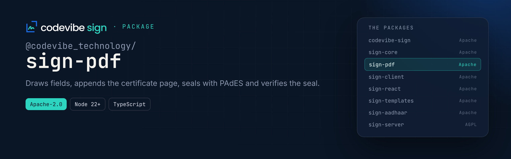

<p align="center">
  <a href="https://sign.codevibe.in?utm_source=github&utm_medium=readme&utm_campaign=sign-pdf&utm_content=banner"></a>
</p>

<p align="center">
  <a href="https://www.npmjs.com/package/@codevibe_technology/sign-pdf"></a>
  <a href="https://www.npmjs.com/package/@codevibe_technology/sign-pdf"></a>
  
  
  <a href="https://github.com/codevibe-technology/codevibe-sign"></a>
</p>

<p align="center">
  <a href="https://sign.codevibe.in/docs?utm_source=github&utm_medium=readme&utm_campaign=sign-pdf&utm_content=nav">Docs</a> ·
  <a href="https://sign.codevibe.in?utm_source=github&utm_medium=readme&utm_campaign=sign-pdf&utm_content=nav">Try it free</a> ·
  <a href="https://github.com/codevibe-technology/codevibe-sign#packages">All packages</a> ·
  <a href="https://github.com/codevibe-technology/codevibe-sign/blob/main/LICENSING.md">Licensing</a> ·
  <a href="https://sign.codevibe.in/docs/changelog?utm_source=github&utm_medium=readme&utm_campaign=sign-pdf&utm_content=nav">Changelog</a> ·
  <a href="https://github.com/codevibe-technology/codevibe-sign">GitHub</a>
</p>

# @codevibe_technology/sign-pdf

The PDF side of Codevibe Sign. It checks uploaded files, draws signatures and field
values onto the pages, appends a signing certificate, and seals the result with a PAdES
signature so any later change is detectable. It also verifies that seal against the
certificate you trust.

Node 22 or later. Built on [pdf-lib](https://pdf-lib.js.org), `@signpdf` and
`node-forge`.

## Install

```sh
pnpm add @codevibe_technology/sign-pdf @codevibe_technology/sign-core
```

## Usage

<!-- check:
import type { AuditEvent, Document, Envelope } from '@codevibe_technology/sign-core';
declare const envelope: Envelope;
declare const document: Document;
declare const events: AuditEvent[];
-->

```ts check
import { readFile } from 'node:fs/promises';
import {
  appendCertificate,
  inspectPdf,
  renderFields,
  seal,
  sealCertificate,
  sha256Hex,
  verify,
} from '@codevibe_technology/sign-pdf';

// 1. On upload: reject encrypted, broken, oversized or overly complex files (read in a
//    worker thread under limits) and record page sizes.
const original = new Uint8Array(await readFile('offer.pdf'));
const { pageCount, pages } = await inspectPdf(original, { maxBytes: 10 * 1024 * 1024 });
const sha256 = sha256Hex(original);
// `pages` maps directly onto core's Document.pageSizes.

// 2. When the envelope completes: draw every value (on a copy stripped of scripts and
//    actions, forms flattened), add the certificate, seal.
const signed = await renderFields(original, envelope.fields, envelope.values, envelope.recipients, {
  documentId: document.id,
  timeZone: 'Asia/Kolkata',
});
const withCertificate = await appendCertificate(signed, {
  envelope,
  document,
  events, // the envelope's audit events, in order
  timeZone: 'Asia/Kolkata',
});
const p12 = new Uint8Array(await readFile(process.env.SEAL_P12_PATH!));
const passphrase = process.env.SEAL_P12_PASSPHRASE;
const sealed = await seal(withCertificate, {
  p12,
  passphrase,
  reason: 'Signed with Codevibe Sign',
  location: 'Bengaluru, India',
});

// 3. Any time later: check the file is exactly what your certificate sealed.
const operator = sealCertificate({ p12, passphrase }); // keep operator.sha256 or operator.pem
const check = await verify(sealed, { trust: { fingerprints: [operator.sha256] } });
// { valid: true, trustedBy: 'certificate', signer: { commonName, organization },
//   signedAt, certificateSha256, seal: { ... } }
```

All failures throw a `SignError` from `@codevibe_technology/sign-core` with a stable `code` and,
where it helps, `details` that name the field or option to fix.

## API

### `inspectPdf(bytes, { maxBytes?, limits? }) → Promise<{ pageCount, pages: { width, height }[] }>`

Page sizes are in PDF points as the page is displayed: the crop box, with width and height
swapped for pages rotated 90 or 270 degrees. This is the space field rects live in.
`maxBytes` defaults to 25 MB.

Use it on every upload. Before the file is parsed on your thread, a worker thread reads it
under `limits` and is terminated if it runs out of time, so one hostile file cannot block the
event loop or exhaust memory:

| Limit             | Default | Refuses                                                             |
| ----------------- | ------- | ------------------------------------------------------------------- |
| `maxPages`        | 500     | More pages than this.                                               |
| `maxObjects`      | 100 000 | More indirect objects than this.                                    |
| `maxDepth`        | 64      | Arrays and dictionaries, or the page tree, nested deeper than this. |
| `maxDecodedBytes` | 50 MB   | Compressed streams that inflate to more than this, together.        |
| `timeoutMs`       | 10 s    | Files that take longer to read; the worker is killed.               |

The worker also has a 512 MB heap; a file that needs more is refused. `checkParseLimits(bytes,
limits?)` runs the same check on its own, and `DEFAULT_PARSE_LIMITS` holds the defaults. The
worker ships inline with its own copy of pdf-lib, so it runs the same whether your app loads this
package from `node_modules` or a bundler (Next.js, webpack, esbuild) inlines it. If the worker
cannot start at all, the check throws a plain `Error`, not `DOCUMENT_INVALID`: the fault is the
host's, not the file's.

It also refuses a PDF that already carries digital signatures (signed `/Sig` fields), with
`PDF_ALREADY_SIGNED` and `details.signatureCount`. Drawing fields and sealing write the file
again, which would silently remove those signatures; ask for the unsigned original instead.
The message is `ALREADY_SIGNED_MESSAGE`, ready to show as is.

Errors: `DOCUMENT_TOO_LARGE`; `PDF_ALREADY_SIGNED`; `DOCUMENT_INVALID` with `details.reason` of
`encrypted`, `unreadable`, `empty`, `timeout` or `limit` (then `details.limit` names it, with
`details.max`).

### `sha256Hex(bytes) → string`

Lowercase hex SHA-256.

### `renderFields(pdfBytes, fields, values, recipients, options?) → Promise<Uint8Array>`

Draws each field onto its page. Rects use core's convention (points from the top-left of
the displayed page); rotated pages and offset crop boxes are handled, and content is
drawn upright as the reader sees it.

The pages are first copied into a fresh document without active content: `/OpenAction`
and `/AA` actions, JavaScript, embedded files, launch, URI and every other action except
in-document links, file attachment and media annotations, and XFA. Form fields are
flattened into the page. Outlines, the structure tree and objects the pages do not use are
left behind, and the output is a newly written file, never an incremental update. The same
step is available on its own as `sanitizePdf(bytes)`.

- `signature`, `initials`: PNG as base64 (a `data:image/png;base64,` prefix is accepted).
  Each image is re-encoded before it is embedded: the header must declare at most
  2048 × 2048 pixels, the pixel data must inflate to exactly the size the header implies,
  every chunk checksum and scanline filter must be valid, and only the header, palette,
  transparency and freshly compressed pixels are kept. Scaled to fit the box, aspect ratio
  kept, centred.
- Under each `signature` image, in small grey type at the foot of the box, the signer's
  name and signing time (`recipient.actedAt`, in `timeZone` or UTC), for example
  `Asha Rao, 19 Nov 2026 15:45 GMT+5:30`. The image shrinks to make room. Boxes under 20
  points tall get no caption; `signatureCaption: false` turns it off.
- `text`, `name`, `date_signed`: Helvetica, sized down (to 6 pt) and wrapped to fit; text
  that still does not fit is cut with an ellipsis. `name` falls back to the recipient's
  name and `date_signed` to the recipient's `actedAt`. Dates print as `19 Nov 2026`.
- `checkbox`: `'true'` or `'false'`; a box is drawn, with a tick when checked.

Boxes that run off the page are trimmed to it.

| Option          | Default | Purpose                                                       |
| --------------- | ------- | ------------------------------------------------------------- |
| `documentId`    | all     | Draw only the fields of this document.                        |
| `font`          | none    | TTF/OTF bytes tried first; see Fonts and scripts.             |
| `timeZone`      | `UTC`   | IANA zone used to turn a `date_signed` timestamp into a date. |
| `formatDate`    | none    | `(isoValue) => string` for `date_signed` text.                |
| `maxImageBytes` | 1 MB    | Largest signature image.                                      |
| `maxBytes`      | 25 MB   | Largest input PDF.                                            |

Errors: `REQUIRED_FIELDS_MISSING` (`details.fieldIds`), `INVALID_FIELD_VALUE` (bad image,
checkbox value), `RECIPIENT_NOT_FOUND`, `VALIDATION`
(page out of range, box outside the page, unknown time zone).

### `appendCertificate(pdfBytes, data, options?) → Promise<Uint8Array>`

Appends an A4 page titled "Signing certificate". `data` is
`{ envelope, document, events, timeZone?, generatedAt?, sender?, recordUrl?, note? }` using
core's types. The page shows:

- the envelope title, document name and page count, envelope id, status and when it was
  completed;
- `sender`, when given: `{ name, organization?, email? }`, the email masked;
- each recipient: name, role, email or phone masked lightly (`s****@example.com`,
  `+91******3210`), how they proved who they are, and when they signed, approved or declined
  (with the reason);
- the document fingerprint: the SHA-256 of the original file (`document.sha256`), in short
  and in full, and the head of the audit chain;
- `recordUrl`, when given: a QR code for a page that shows this signing's record, such as the
  public record page of the web app. The code is also a link in PDF readers; the address
  itself is not printed;
- under the code, "Signing certificate provided by:" and the Codevibe Sign logo, drawn as
  vector paths so it needs no font;
- `note`, when given: one line from the sender at the end, such as a company registration
  number.

IP addresses, browser details and the list of audit events are not printed; `auditTrailPdf`
makes the event list a file of its own. Times are shown in the given time zone with UTC
under them, or in UTC alone. A usual envelope fits one page; with many recipients the table
continues on further pages with its header repeated.

`options`: `font` (as above) and `maxBytes`.

### `certificatePdf(data, options?) → Promise<Uint8Array>`

The same certificate as a PDF of its own, without the document: for someone who should see
who signed and when, but not what was signed. `data` is one `CertificateData` or an array, to
put the certificates of several documents in one file. `options`: `font`.

### `auditTrailPdf(data, options?) → Promise<Uint8Array>`

The audit trail as a PDF. `data` is `{ envelope, events, timeZone?, generatedAt?, recordUrl? }`.
Every event is listed with its number, time, what happened and who did it, above the head of
the hash chain. IP addresses and browser details are left out and an email address named in
an event is masked. `options`: `font`.

### `seal(pdfBytes, options) → Promise<Uint8Array>`

Applies a PAdES signature: SubFilter `ETSI.CAdES.detached`, SHA-256 with RSA, signed
attributes content-type, message-digest and signing-certificate-v2, signing time in the
signature dictionary (baseline B-B). With `tsaUrl` it also carries an RFC 3161 signature
timestamp as the unsigned attribute signature-time-stamp-token (baseline B-T). The seal
covers the whole file and, being the first signature, is a certification signature with
DocMDP permissions P=1: readers show the file as certified and flag any later change.

| Option               | Purpose                                                                 |
| -------------------- | ----------------------------------------------------------------------- |
| `p12`                | PKCS#12 (`.p12`/`.pfx`) bytes with an RSA key, its cert and any issuer. |
| `passphrase`         | The file's passphrase.                                                  |
| `signer`             | A `SealProvider` to sign with instead of `p12`; see below.              |
| `reason`             | Shown by PDF readers. Has a sensible default.                           |
| `location`           | Optional.                                                               |
| `contactInfo`        | Optional.                                                               |
| `signingTime`        | Defaults to now. Must fall inside the certificate validity.             |
| `maxBytes`           | Largest input PDF, 25 MB by default.                                    |
| `allowWeakKey`       | Local development only; see below.                                      |
| `tsaUrl`             | RFC 3161 timestamp authority, such as `http://timestamp.digicert.com`.  |
| `tsaRequired`        | Fail when the authority fails. Default `true` when `tsaUrl` is set.     |
| `tsaTimeoutMs`       | How long to wait for the authority, 15 seconds by default.              |
| `onTimestampFailure` | Called with the error when an optional timestamp was skipped.           |
| `certify`            | `false` makes an ordinary approval signature instead of certifying.     |

The key must be RSA of at least 2048 bits and the certificate signed with SHA-256 or
stronger, and valid (not expired, not yet to start) at the signing time. `allowWeakKey: true`
accepts shorter keys and SHA-1 certificates, for throwaway keys in local development; never
set it in production.

The seal certificate may be a single self-signed certificate, or a leaf issued by your own
private root (see `deploy/README.md`) or by a CA. A leaf issued by a CA must say `CA:FALSE`;
when key usage is present it must allow digitalSignature or nonRepudiation, and when extended
key usage is present it must include documentSigning (1.3.6.1.5.5.7.3.36), msDocumentSigning
(1.3.6.1.4.1.311.10.3.12), Adobe authentic documents, emailProtection or any. Issuing
certificates found in the `.p12` are checked (each signed the one below it, is a CA and is
valid at the signing time) and embedded in the signature, so a verifier only needs the root.

The timestamp is requested over the signature value with a fresh nonce. The answer must be
granted, carry the same nonce and SHA-256 imprint, and be signed by the authority; otherwise
sealing fails with `SEAL_FAILED` and `details.option` `tsaUrl`, unless `tsaRequired` is false.

A file that already carries signatures is refused with `PDF_ALREADY_SIGNED`: sealing writes
the whole file again and would remove them. Use `countersign()` for such a file.

#### Signers

`p12Signer({ p12, passphrase })` is what `seal()` uses by default. To keep the key elsewhere,
pass `signer`, any object with `certificateChain()` (DER, seal certificate first) and
`sign(data)` (SHA-256 with RSA PKCS#1 v1.5 over `data`, returning the raw signature).
`pkcs11Signer()` (HSM or token) and `cscSigner()` (Cloud Signature Consortium remote signing)
are typed placeholders in this version: each call fails with `SEAL_FAILED` and
`details.provider`.

The certificate is the operator's, not the signer's: it proves the file has not changed
since sealing. Signer intent is proven by the certificate page and the audit trail.
Errors: `SEAL_FAILED` (bad file or passphrase, no RSA key, weak key or certificate with
`details.keyBits` or `details.signatureAlgorithm`, certificate not valid at the signing time,
a certificate profile problem with `details.reason`, a timestamp failure), `PDF_ALREADY_SIGNED`
and the `DOCUMENT_*` codes above.

### `countersign(pdfBytes, options) → Promise<Uint8Array>`

Seals a file that is already signed, for example one that came back from an eSign provider
with an Aadhaar eSign in it. It takes the same options as `seal()`.

#### Sealing a file that is already signed

A digital signature covers the bytes of the file as it was when it was made. `seal()` writes
the file again, which would break such a signature, so `countersign()` leaves every existing
byte where it is and appends one incremental update after them: an approval signature from
the operator in an invisible field, plus the few objects that have to name that field (the
form, and the first page's annotation list). The output starts with the input, byte for
byte.

Adding a signature is a change earlier signatures permit. The earlier signature stays valid
and is shown as covering the file up to the point where it was made; the operator's seal
covers the whole file, earlier signatures included. Nothing else can be added this way:
drawing on a page or appending a certificate page after someone else's signature would make
readers report that signature as broken. Draw the fields before the file goes to the
provider, and keep the certificate as a file of its own (`certificatePdf`).

```ts
const signedByProvider = await provider.fetchSignedDocument(ref);
const sealed = await countersign(signedByProvider, { p12, passphrase, tsaUrl });

const check = await verify(sealed, { trust, allowEarlierSignatures: true });
check.valid; // the seal is the operator's and covers everything
check.earlierSignatures; // the provider's signature: signer, issuer, time, still intact
```

It works on files with a classic cross-reference table and on files with cross-reference
and object streams, and continues with whichever the file ends with. The seal is never a
certification (`certify` is ignored), since only the first signature of a file can be one.

Errors: `VALIDATION` when the file carries no signature (use `seal()`), `DOCUMENT_INVALID`
for an encrypted or unreadable file, the `SEAL_FAILED` cases of `seal()`, and
`PDF_ALREADY_SIGNED` with `details.reason` `locked` when an existing signature forbids
another one: a certification that allows no changes (DocMDP `P` 1), or a signature field
lock that covers fields it does not name. Keep such a file as it is.

### `sealCertificate({ p12, passphrase?, allowWeakKey?, at? }) → SealCertificate`

Opens the PKCS#12 file with the same checks as `seal()` and returns
`{ pem, sha256, subject, notBefore, notAfter }`. Call it at start-up to fail early, and keep
`sha256` (or `pem`) as what `verify()` should trust.

### `createDevSeal(options?) → DevSeal`

Creates a self-signed RSA-2048 sealing certificate for development and tests and returns
`{ p12, passphrase, certificatePem, sha256, notBefore, notAfter }`. Options: `commonName`,
`organization`, `days` (default 365, at most 3650), `passphrase` (generated when omitted) and
`notBefore`. PDF readers show seals made with it as untrusted; production needs a certificate
issued by a certificate authority. Node only.

### `verify(bytes, { trust, limits?, allowEarlierSignatures? }) → Promise<VerifyResult>`

The check to use when deciding whether a file is genuine. `valid` is true only when:

1. the file has exactly one signature, found through its form's signature field;
2. that signature is cryptographically intact (see `verifySeal`);
3. it covers every byte of the file, so nothing was appended after sealing;
4. the signer certificate is one you trust: its SHA-256 is in `trust.fingerprints`, it is
   one of `trust.certificates` (PEM or DER), or it chains through the certificates in the
   signature to one of `trust.roots` and was valid at the signing time.

`trust` must name at least one certificate, fingerprint or root. The file is read under the
parser limits in a worker first, as in `inspectPdf`.

With `allowEarlierSignatures: true` the file may carry signatures made before the seal, as
`countersign()` produces. The seal must then be the latest signature and meet conditions 2
to 4, and every earlier signature must still match the bytes it covers. The result lists
them in `earlierSignatures`; their certificates are not checked against `trust`.

```ts
interface VerifyResult {
  valid: boolean;
  reason?:
    | 'not_sealed'
    | 'multiple_signatures'
    | 'signature_invalid'
    | 'not_whole_document'
    | 'earlier_signature_invalid'
    | 'content_between_signatures'
    | 'untrusted_signer';
  signer?: { commonName?: string; organization?: string };
  signedAt?: string;
  certificateSha256?: string; // of the signer certificate
  trustedBy?: 'certificate' | 'root';
  seal: SealVerification; // the low-level result below, for the operator's signature
  earlierSignatures?: SignatureInfo[]; // with allowEarlierSignatures, when there are any
}
```

Keep the certificates of earlier keys in `trust` after a rotation, so files they sealed
keep verifying.

### `verifySeal(bytes) → Promise<SealVerification>`

The low-level check `verify()` builds on. It takes the first signed signature field of the
document's form (text that only looks like a signature dictionary is ignored), and checks
that its byte range is well formed and brackets the `/Contents` the field declares,
`/Contents` holds exactly the CMS structure (any change to it, even in padding, fails), the
message digest matches the signed bytes, the signing-certificate-v2 hash matches the
embedded certificate, and the signature verifies with the certificate's key.

In a file with several signatures this is the first one in the form, which covers only the
part of the file that existed when it was made. Use `verifySignatures` for such a file.

```ts
interface SealVerification {
  sealed: boolean; // a signature is present
  valid: boolean; // it is intact and matches the bytes it covers
  coversWholeDocument: boolean; // false if anything was appended after sealing
  signer?: { commonName?: string; organization?: string };
  signedAt?: string; // ISO time
  signatureCount: number;
  timestampedAt?: string; // ISO time from a valid RFC 3161 signature timestamp
}
```

`timestampedAt` is set only when the timestamp token's imprint matches the signature and the
authority's signature on the token verifies; whether the authority is trusted is not checked.

`valid` says nothing about who sealed the file: anyone can seal an altered copy with their
own key and `verifySeal` will call it valid. It also runs without parser limits. Use
`verify()` with your operator certificate to decide whether a file is genuine.

### `verifySignatures(bytes) → Promise<SignatureInfo[]>`

Every signature of the file, from the earliest to the latest, each checked like `verifySeal`
checks one. It reads CMS signatures in `ETSI.CAdES.detached` and `adbe.pkcs7.detached` form,
made with RSA (PKCS#1 v1.5 or PSS) or ECDSA keys and SHA-256, SHA-384 or SHA-512, so it can
tell whether a signature from another product is intact. A signature that does not cover the
ones before it is reported as not valid.

```ts
interface SignatureInfo {
  valid: boolean; // intact, and covers the signatures before it
  coversWholeDocument: boolean;
  coveredBytes: number; // the length of the file when it was signed
  signer?: { commonName?: string; organization?: string };
  issuer?: { commonName?: string; organization?: string }; // who issued the certificate
  signedAt?: string;
  certificateSha256?: string;
  subFilter?: string; // for example 'adbe.pkcs7.detached'
  timestampedAt?: string;
}
```

Like `verifySeal`, it says nothing about who a signer is: it does not check certificate
chains, revocation or whether a certifying authority is trusted. Open the file in a PDF
reader to see the reader's own verdict on a provider's certificate.

### `maskEmail(email)`, `maskPhone(phone)`

The masking used on the certificate, for reuse in emails and screens.

## Fonts and scripts

Names, titles and field text can be in any of these scripts without extra setup:
Devanagari (Hindi, Marathi, Nepali), Bengali, Gurmukhi, Gujarati, Odia, Tamil, Telugu,
Kannada, Malayalam, Arabic (including Urdu), and Latin, Greek and Cyrillic beyond the
WinAnsi set. Text the standard fonts can encode stays in Helvetica; everything else is
drawn with the bundled Noto Sans fonts. Each run is shaped with HarfBuzz, so conjuncts
(क्ष, त्र, श्री), vowel signs and Arabic joining come out right, and only the glyphs used
are embedded: a certificate with a Hindi name grows by about 2 KB. Copying or searching
the PDF gives back the text as typed. Characters no font covers (emoji, for example)
become `?` rather than failing.

For other scripts, such as Chinese, Japanese or Korean, pass a font that covers them as
`font` to `renderFields`, `appendCertificate`, `certificatePdf` and `auditTrailPdf`. It
is tried first for every character it has. A TrueType font is shaped and subset like the
bundled ones; a CFF-based OpenType font is embedded whole and laid out by pdf-lib.

<!-- check:
import { readFile } from 'node:fs/promises';
import { appendCertificate, renderFields, type CertificateData } from '@codevibe_technology/sign-pdf';
import type { Envelope } from '@codevibe_technology/sign-core';
declare const pdf: Uint8Array;
declare const signed: Uint8Array;
declare const data: CertificateData;
declare const envelope: Envelope;
const { fields, values, recipients } = envelope;
-->

```ts check
const font = new Uint8Array(await readFile('NotoSansSC-Regular.otf'));
await renderFields(pdf, fields, values, recipients, { font });
await appendCertificate(signed, data, { font });
```

The bundled fonts are Noto Sans, under the SIL Open Font License 1.1 (see `fonts/OFL.txt`).

## Limits

- Sealing keys must be RSA. Encrypted PDFs are rejected rather than decrypted.
- Sealing rewrites the file; seal last. For a file that already carries someone else's
  signature use `countersign()`, which only appends.
- `verify`, `verifySeal` and `verifySignatures` locate signatures through the form's
  signature fields and check that each matches its bytes. They are not a general PDF
  signature validator: no certificate chain or revocation checks for other signers, no
  long-term validation. Signatures in forms other than detached CMS (for example
  `adbe.pkcs7.sha1` or `adbe.x509.rsa_sha1`) and CMS that is not DER encoded are reported as
  not valid.
- Sanitising drops document-level features such as bookmarks and the tagged structure tree.

## Docs

Guides and the full API reference are at [sign.codevibe.in](https://sign.codevibe.in?utm_source=github&utm_medium=readme&utm_campaign=sign-pdf&utm_content=body).

## Licence

Apache-2.0 © Codevibe

---

### The Codevibe Sign packages

| Package                                                                                                    | What it does                                                                                        | Licence    |
| ---------------------------------------------------------------------------------------------------------- | --------------------------------------------------------------------------------------------------- | ---------- |
| [`codevibe-sign`](https://www.npmjs.com/package/codevibe-sign)                                             | The one library to install: API client, PDF tools, core rules, React components and a command line. | Apache-2.0 |
| [`@codevibe_technology/sign-core`](https://www.npmjs.com/package/@codevibe_technology/sign-core)           | Envelopes, routing, reminders, expiry and a hash-chained audit log. No I/O.                         | Apache-2.0 |
| [`@codevibe_technology/sign-pdf`](https://www.npmjs.com/package/@codevibe_technology/sign-pdf)             | Draws fields, appends the certificate page, seals with PAdES and verifies the seal.                 | Apache-2.0 |
| [`@codevibe_technology/sign-client`](https://www.npmjs.com/package/@codevibe_technology/sign-client)       | Typed client for the HTTP API, signing sessions and webhook checks. No dependencies.                | Apache-2.0 |
| [`@codevibe_technology/sign-react`](https://www.npmjs.com/package/@codevibe_technology/sign-react)         | Signature pad, signing view and field placer for your own React app.                                | Apache-2.0 |
| [`@codevibe_technology/sign-templates`](https://www.npmjs.com/package/@codevibe_technology/sign-templates) | Templates with roles and prefilled fields, and bulk send from CSV.                                  | Apache-2.0 |
| [`@codevibe_technology/sign-aadhaar`](https://www.npmjs.com/package/@codevibe_technology/sign-aadhaar)     | Aadhaar eSign through a licensed eSign provider, with your own account. Standalone for now.         | Apache-2.0 |
| [`@codevibe_technology/sign-server`](https://www.npmjs.com/package/@codevibe_technology/sign-server)       | The HTTP API and runtime: storage, mail, one-time codes, webhooks and sealing.                      | AGPL-3.0   |

The web app, the Docker image and the docs live in the [Codevibe Sign repository](https://github.com/codevibe-technology/codevibe-sign). Try it free at [sign.codevibe.in](https://sign.codevibe.in?utm_source=github&utm_medium=readme&utm_campaign=sign-pdf&utm_content=footer), or self-host it with no limits.

<p align="center">
  <a href="https://codevibe.in?utm_source=github&utm_medium=readme&utm_campaign=sign-pdf&utm_content=footer-logo">
    <picture>
      <source media="(prefers-color-scheme: dark)" srcset="https://raw.githubusercontent.com/codevibe-technology/codevibe-sign/main/.github/assets/codevibe-logo-light.png">
      
    </picture>
  </a>
</p>

<p align="center">
  Built and maintained by <a href="https://codevibe.in?utm_source=github&utm_medium=readme&utm_campaign=sign-pdf&utm_content=built-by"><b>Codevibe</b></a>, a software development agency in Gurugram, India.<br>
  <a href="https://sign.codevibe.in?utm_source=github&utm_medium=readme&utm_campaign=sign-pdf&utm_content=footer-links">Codevibe Sign</a> · <a href="https://sign.codevibe.in/docs?utm_source=github&utm_medium=readme&utm_campaign=sign-pdf&utm_content=footer-links">Docs</a> · <a href="https://codevibe.in/tools/codevibe-sign?utm_source=github&utm_medium=readme&utm_campaign=sign-pdf&utm_content=footer-links">Product page</a> · <a href="mailto:hello@codevibe.in">hello@codevibe.in</a>
</p>
