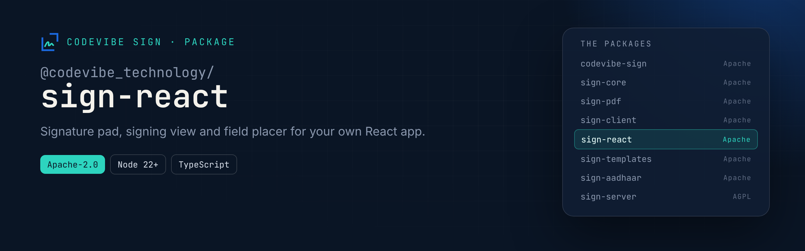

<p align="center">
  <a href="https://sign.codevibe.in?utm_source=github&utm_medium=readme&utm_campaign=sign-react&utm_content=banner"></a>
</p>

<p align="center">
  <a href="https://www.npmjs.com/package/@codevibe_technology/sign-react"></a>
  <a href="https://www.npmjs.com/package/@codevibe_technology/sign-react"></a>
  
  
  <a href="https://github.com/codevibe-technology/codevibe-sign"></a>
</p>

<p align="center">
  <a href="https://sign.codevibe.in/docs?utm_source=github&utm_medium=readme&utm_campaign=sign-react&utm_content=nav">Docs</a> ·
  <a href="https://sign.codevibe.in?utm_source=github&utm_medium=readme&utm_campaign=sign-react&utm_content=nav">Try it free</a> ·
  <a href="https://github.com/codevibe-technology/codevibe-sign#packages">All packages</a> ·
  <a href="https://github.com/codevibe-technology/codevibe-sign/blob/main/LICENSING.md">Licensing</a> ·
  <a href="https://sign.codevibe.in/docs/changelog?utm_source=github&utm_medium=readme&utm_campaign=sign-react&utm_content=nav">Changelog</a> ·
  <a href="https://github.com/codevibe-technology/codevibe-sign">GitHub</a>
</p>

# @codevibe_technology/sign-react

React components for electronic signatures: a signature pad (draw, type or upload), a
signing view for recipients and a field placer for senders. They read and write the
types from `@codevibe_technology/sign-core` (`Field`, `FieldValue`, `Recipient`), so what the
placer emits and what the signing view submits go straight to the core workflow.

No CSS framework. Styling comes from one small stylesheet driven by `--cvs-*` custom
properties, with a light and a dark palette.

## Install

```sh
pnpm add @codevibe_technology/sign-react @codevibe_technology/sign-core
# To render PDFs with the built-in renderer:
pnpm add pdfjs-dist
```

React 18 or 19. `pdfjs-dist` is an optional peer dependency, loaded only when a document
is given as a `file`; pass your own `source` to render pages another way.

```ts
import '@codevibe_technology/sign-react/styles.css';
```

## Usage

<!-- check:
import type { Envelope, Field, Recipient } from '@codevibe_technology/sign-core';
declare const doc: { id: string; name: string };
declare const envelope: Envelope;
declare const pdfBytes: Uint8Array;
declare const pdfUrl: string;
declare const fields: Field[];
declare const setFields: (fields: Field[]) => void;
declare const workerSrc: string;
declare const me: Recipient;
declare const api: { submit(values: unknown): Promise<void>; decline(reason: string): Promise<void> };
declare const png: string | null;
declare const setPng: (png: string | null) => void;
-->

```tsx check
import { FieldPlacer, SigningView, SignaturePad } from '@codevibe_technology/sign-react';

// Sender: place fields for each signer.
const placer = (
  <FieldPlacer
    documents={[{ id: doc.id, name: doc.name, file: pdfBytes }]}
    recipients={envelope.recipients}
    fields={fields}
    onChange={setFields}
    pdf={{ workerSrc }}
  />
);

// Recipient: fill and sign their own fields.
const signing = (
  <SigningView
    documents={[{ id: doc.id, file: pdfUrl }]}
    fields={envelope.fields}
    recipient={me}
    onSubmit={(values) => api.submit(values)}
    onDecline={(reason) => api.decline(reason)}
  />
);

// Just the pad. Value is PNG base64 without the data URL prefix.
const pad = <SignaturePad value={png} onChange={setPng} aspectRatio={3} />;
```

With pdf.js you usually need to tell it where its worker is. In Vite:

```ts
import * as pdfjs from 'pdfjs-dist';
import workerSrc from 'pdfjs-dist/build/pdf.worker.min.mjs?url';
const pdf = { pdfjs, workerSrc };
```

Or skip pdf.js and supply a `source`: `{ pages: PageSize[]; renderPage(pageIndex, scale, signal) }`,
where `renderPage` resolves to a canvas, image or `ImageBitmap` drawn at `scale` device
pixels per PDF point.

## With the server

The components never talk to a server themselves: you load the signer's page, pass it in and
send what they return. With `@codevibe_technology/sign-server` the contract is:

- `GET /v1/sign/:token` returns `{ envelope, recipient, documents, fields, values,
otpRequired, authenticated, canAct }`. Pass `recipient`, `fields` and `values` (as
  `initialValues`) to `SigningView` as they are.
- Recipients with `email_otp` or `sms_otp` must verify a code before anything else:
  `POST /v1/sign/:token/otp` sends it and `POST /v1/sign/:token/otp/verify` with `{ code }`
  returns `{ sessionToken, expiresAt }` and sets the `cvsign_session` cookie on path
  `/v1/sign` (HTTP-only, `SameSite=Strict`, 30 minutes). Until then the document download,
  `view`, `submit` and `decline` answer `OTP_INVALID`.
- Send the session with every later request: the cookie works when the page is served from
  the same origin as the API (the server sends no CORS headers), otherwise send the
  `X-Sign-Session` header from your own proxy.
- `POST /v1/sign/:token/view` records that the signer opened the document.
- `POST /v1/sign/:token/submit` takes `{ "consent": true, "values": [...] }`. `consent` must be
  `true`, so show your consent text near the Finish button; submitting is the signer's
  agreement to it.
- `POST /v1/sign/:token/decline` takes `{ "reason" }`.
- Errors are `{ "error": { "code", "message" } }`. Throw from `onSubmit` or `onDecline` and
  `SigningView` shows the message.

A complete page, served from the same origin as the API:

```tsx check
import { useEffect, useState } from 'react';
import type { Field, FieldValue } from '@codevibe_technology/sign-core';
import { SigningView } from '@codevibe_technology/sign-react';

interface SignerPage {
  recipient: { id: string; name: string };
  documents: { id: string; name: string }[];
  fields: Field[];
  values: FieldValue[];
  otpRequired: boolean;
  authenticated: boolean;
}

async function call<T>(token: string, path: string, body?: unknown): Promise<T> {
  const res = await fetch(`/v1/sign/${token}${path}`, {
    method: body === undefined ? 'GET' : 'POST',
    headers: body === undefined ? {} : { 'content-type': 'application/json' },
    body: body === undefined ? undefined : JSON.stringify(body),
  });
  const json = await res.json();
  if (!res.ok) throw new Error(json.error?.message ?? 'Something went wrong');
  return json as T;
}

export function SignPage({ token }: { token: string }) {
  const [page, setPage] = useState<SignerPage | null>(null);
  const [code, setCode] = useState('');
  const [done, setDone] = useState(false);
  const load = () => call<SignerPage>(token, '').then(setPage);

  useEffect(() => void load(), [token]);
  const locked = !page || (page.otpRequired && !page.authenticated);
  useEffect(() => {
    if (!locked) void call(token, '/view', {});
  }, [locked, token]);

  if (done)
    return <p>Thank you. You will get the signed copy by email once everyone has signed.</p>;
  if (!page) return <p>Loading…</p>;
  if (locked) {
    return (
      <form
        onSubmit={async (event) => {
          event.preventDefault();
          await call(token, '/otp/verify', { code });
          await load();
        }}
      >
        <button type="button" onClick={() => void call(token, '/otp', {})}>
          Email me a code
        </button>
        <input value={code} onChange={(e) => setCode(e.target.value)} inputMode="numeric" />
        <button type="submit">Verify</button>
      </form>
    );
  }
  return (
    <>
      <p>By selecting Finish you agree to sign this document electronically.</p>
      <SigningView
        documents={page.documents.map((d) => ({
          ...d,
          file: `/v1/sign/${token}/documents/${d.id}`,
        }))}
        fields={page.fields}
        recipient={page.recipient}
        initialValues={page.values}
        onSubmit={async (values) => {
          await call(token, '/submit', { consent: true, values });
          setDone(true);
        }}
        onDecline={async (reason) => {
          await call(token, '/decline', { reason });
          setDone(true);
        }}
      />
    </>
  );
}
```

## Coordinates

Every `Field.rect` is in PDF points (1/72 inch) measured from the top-left corner of the
page as displayed, which is the crop box with the page rotation applied (what pdf.js
reports at scale 1). Use `flipVertical(rect, pageSize)` to get the bottom-left origin
that PDF content streams use. Placed rects are rounded to 1/100 point.

## API

### Components

| Component      | Key props                                                                                                                                                                                |
| -------------- | ---------------------------------------------------------------------------------------------------------------------------------------------------------------------------------------- |
| `SignaturePad` | `value`, `onChange(png \| null)`, `modes`, `defaultMode`, `aspectRatio`, `fonts`, `colors`, `defaultText`, `upload`, `labels`                                                            |
| `SigningView`  | `documents`, `fields`, `recipient`, `onSubmit(values)`, `onDecline(reason)`, `initialValues`, `today`, `signaturePad`, `pdf`, `labels`, `confirmBeforeFinish`                            |
| `FieldPlacer`  | `documents`, `recipients`, `fields` or `defaultFields`, `onChange(fields)`, `fieldTypes`, `fieldSizes`, `snapThreshold`, `createId`, `pdf`, `labels`, `previewing`, `onPreviewingChange` |

The field placer has a field tray grouped as signature, signer details (name, and email,
company and title as labelled text fields) and inputs; a page rail; undo and redo; copy,
paste and duplicate; Shift-click to select several fields and move, align or reassign them;
resize handles on every corner; alignment guides while dragging; a summary of each signer's
fields that flags a signer with no signature field; and a preview of the pages as a signer
will see them. `SigningView` can ask the signer to confirm before it calls `onSubmit`, and
offers ready-made reasons when they decline.

Every visible string comes from a `labels` prop with English defaults
(`defaultSignaturePadLabels`, `defaultSigningViewLabels`, `defaultFieldPlacerLabels`).

### Hooks

- `useSignaturePad(options)`: mode, strokes, undo and clear, typed text and font,
  upload, and `canvasProps` to spread on your own `<canvas>`.
- `useFieldPlacement(options)`: fields, selection, `addField`, `moveField`,
  `resizeField`, `setFieldRect`, `nudgeField`, `updateField`, `removeField`, `setFields`,
  and for many pages
  `setFieldPages`, `pagesOf`, `repeatField`, `groupOf`, `applyToGroup`, `removeGroup`,
  `addInitialsEveryPage`, `addSignatureLastPage`, `addFields`. All rects in points. A field
  added without a drop point is moved clear of the fields already on its page.

### Many pages and text tags

A placed field starts on its own page only. "Show on pages" in the field panel puts it on
all pages or on typed pages ("1, 3, 5-7"), and takes it off the pages left out, at the same
spot relative to each page, so it lands in the same place on A4 and Letter and on turned
pages. The choice applies when it is picked; there is no second button. Copies stay plain fields: a group is
any set of fields of one recipient and type at the same relative spot, so it is found again
after a reload. Quick add places initials in the corner of every page or a signature on the
last page.

When pdf.js can read the document's text, tags such as `{{signature:1}}` are found and
"Place fields from tags" covers each with a field. The number is the recipient's place in
the signing order. Types: `signature`, `initials`, `date`, `name`, `text`, `checkbox`.

A recipient with `auth: 'aadhaar'` has no fields: the eSign provider places their signature
where its own workflow says. While such a signer is picked the placer offers nothing to
place and says so (`aadhaarHint`), the summary notes it (`aadhaarSummary`) and asks for no
signature. Pass `recipient.auth` to `SigningView` and its bar says there is nothing to fill
in (`aadhaarOnly`); an `aadhaar` box of an envelope sent while it existed is not shown.

With the same text, a signature or initials field that covers page text gets a dashed
outline and an "Over text" badge, and the side panel says how many do. It is a warning
only: the drawn signature would hide the words under it, but the sender may still place it.
Signature lines (`____`), dots and tags under a field do not count.

The signing view asks for a signature or initials once; each further box then takes one
tap, and "Fill all my initials" fills every initials box after the first is adopted. A
signature saved on an earlier visit counts as adopted, and redoing it replaces it in every
box that used it.

### Layout of the signing view

Give `SigningView` a height (a fixed one, or a place in a flex or grid layout) and the pages
scroll inside it, up and down and, zoomed in, sideways, with the action bar pinned under
them. Without a height the view grows with the pages, the host page scrolls them and the
action bar sticks to the bottom of the window; for that, no ancestor may set `overflow` to
`hidden`, `auto` or `scroll` (`overflow: clip` is fine).

- `usePdfSources(documents, pdfOptions)`: resolves documents to page sources.

### Helpers

`validateFieldValues`, `toFieldValues`, `prefillValues`, `sortFields`, `fieldStatus`,
`isoDate`; `pointsToPixels`, `pixelsToPoints`, `clientToPoints`, `scaleForWidth`,
`clampRect`, `snapToPageEdges`, `flipVertical`; `createField`, `nudgeRect`,
`defaultFieldSizes`, `freeRect`; `parsePageRange`, `formatPageList`, `pagesForChoice`,
`choiceForPages`, `scaleRectBetween`,
`fieldGroups`, `repeatField`, `initialsOnEveryPage`, `signatureOnLastPage`, `findTags`,
`fieldsFromTags`, `coveredText`, `fieldsOverText`; `encodeSignature`, `imageFileToSignature`; `loadPdf`.

Signature images are always trimmed and re-encoded to PNG, and capped at core's
`MAX_IMAGE_BYTES` (512 KB; 200 KB by default). Uploads accept PNG, JPEG and WebP up to
5 MB, have their paper background removed and never pass the original bytes through.
Field values are checked with core's `checkFieldValue`, the same rules the server uses.

### Keyboard

- Signature pad: arrow keys, Home and End move between Draw, Type and Upload. Type mode
  is the keyboard route to a signature.
- Field placer: Enter on a palette item adds the field to the page in view. On a placed
  field, arrow keys move it 1 point (Shift: 10), Alt with arrows resizes it, Delete
  removes it, Escape deselects.
- Field placer: picking "This page only", "All pages" or "Specific pages…" under "Show on
  pages" applies at once; typed page numbers apply on Enter.
- Signing view: one guide button reads Start, then Next, and Sign or Initial while the
  guide is on a signature box; it moves focus to the next required field in reading order.
  Enter in a text field moves on too, and Finish takes over when nothing is left. Dialogs
  trap focus and close on Escape.

## Theming

Set any of these on `:root` or a container. Add `data-cvs-theme="dark"` to a container
for the dark palette, or `data-cvs-theme="auto"` to follow the system.

| Variable                                                        | Use                                   |
| --------------------------------------------------------------- | ------------------------------------- |
| `--cvs-font`, `--cvs-font-size`                                 | Type                                  |
| `--cvs-radius`, `--cvs-radius-sm`                               | Corner radius                         |
| `--cvs-tap`                                                     | Minimum touch target (44px)           |
| `--cvs-bg`, `--cvs-surface`, `--cvs-surface-muted`              | Backgrounds                           |
| `--cvs-text`, `--cvs-text-muted`, `--cvs-border`                | Text and lines                        |
| `--cvs-accent`, `--cvs-accent-text`, `--cvs-focus`              | Primary actions and focus ring        |
| `--cvs-danger`, `--cvs-success`                                 | States                                |
| `--cvs-backdrop`, `--cvs-shadow`                                | Dialogs and pages                     |
| `--cvs-page-bg`, `--cvs-pad-bg`, `--cvs-pad-line`               | Page and pad surfaces                 |
| `--cvs-field-bg`, `--cvs-field-border`, `--cvs-field-filled-bg` | Fields waiting for the signer         |
| `--cvs-recipient-0` … `--cvs-recipient-5`                       | Recipient colours in the field placer |

Animations and transitions are turned off under `prefers-reduced-motion`.

## Docs

Guides and the full API reference are at [sign.codevibe.in](https://sign.codevibe.in?utm_source=github&utm_medium=readme&utm_campaign=sign-react&utm_content=body).

## Licence

Apache-2.0 © Codevibe

---

### The Codevibe Sign packages

| Package                                                                                                    | What it does                                                                                        | Licence    |
| ---------------------------------------------------------------------------------------------------------- | --------------------------------------------------------------------------------------------------- | ---------- |
| [`codevibe-sign`](https://www.npmjs.com/package/codevibe-sign)                                             | The one library to install: API client, PDF tools, core rules, React components and a command line. | Apache-2.0 |
| [`@codevibe_technology/sign-core`](https://www.npmjs.com/package/@codevibe_technology/sign-core)           | Envelopes, routing, reminders, expiry and a hash-chained audit log. No I/O.                         | Apache-2.0 |
| [`@codevibe_technology/sign-pdf`](https://www.npmjs.com/package/@codevibe_technology/sign-pdf)             | Draws fields, appends the certificate page, seals with PAdES and verifies the seal.                 | Apache-2.0 |
| [`@codevibe_technology/sign-client`](https://www.npmjs.com/package/@codevibe_technology/sign-client)       | Typed client for the HTTP API, signing sessions and webhook checks. No dependencies.                | Apache-2.0 |
| [`@codevibe_technology/sign-react`](https://www.npmjs.com/package/@codevibe_technology/sign-react)         | Signature pad, signing view and field placer for your own React app.                                | Apache-2.0 |
| [`@codevibe_technology/sign-templates`](https://www.npmjs.com/package/@codevibe_technology/sign-templates) | Templates with roles and prefilled fields, and bulk send from CSV.                                  | Apache-2.0 |
| [`@codevibe_technology/sign-aadhaar`](https://www.npmjs.com/package/@codevibe_technology/sign-aadhaar)     | Aadhaar eSign through a licensed eSign provider (Leegality). Used by the server and the web app.    | Apache-2.0 |
| [`@codevibe_technology/sign-server`](https://www.npmjs.com/package/@codevibe_technology/sign-server)       | The HTTP API and runtime: storage, mail, one-time codes, webhooks and sealing.                      | AGPL-3.0   |

The web app, the Docker image and the docs live in the [Codevibe Sign repository](https://github.com/codevibe-technology/codevibe-sign). Try it free at [sign.codevibe.in](https://sign.codevibe.in?utm_source=github&utm_medium=readme&utm_campaign=sign-react&utm_content=footer), or self-host it with no limits.

<p align="center">
  <a href="https://codevibe.in?utm_source=github&utm_medium=readme&utm_campaign=sign-react&utm_content=footer-logo">
    <picture>
      <source media="(prefers-color-scheme: dark)" srcset="https://raw.githubusercontent.com/codevibe-technology/codevibe-sign/main/.github/assets/codevibe-logo-light.png">
      
    </picture>
  </a>
</p>

<p align="center">
  Built and maintained by <a href="https://codevibe.in?utm_source=github&utm_medium=readme&utm_campaign=sign-react&utm_content=built-by"><b>Codevibe</b></a>, a software development agency in Gurugram, India.<br>
  <a href="https://sign.codevibe.in?utm_source=github&utm_medium=readme&utm_campaign=sign-react&utm_content=footer-links">Codevibe Sign</a> · <a href="https://sign.codevibe.in/docs?utm_source=github&utm_medium=readme&utm_campaign=sign-react&utm_content=footer-links">Docs</a> · <a href="https://codevibe.in/tools/codevibe-sign?utm_source=github&utm_medium=readme&utm_campaign=sign-react&utm_content=footer-links">Product page</a> · <a href="mailto:hello@codevibe.in">hello@codevibe.in</a>
</p>
