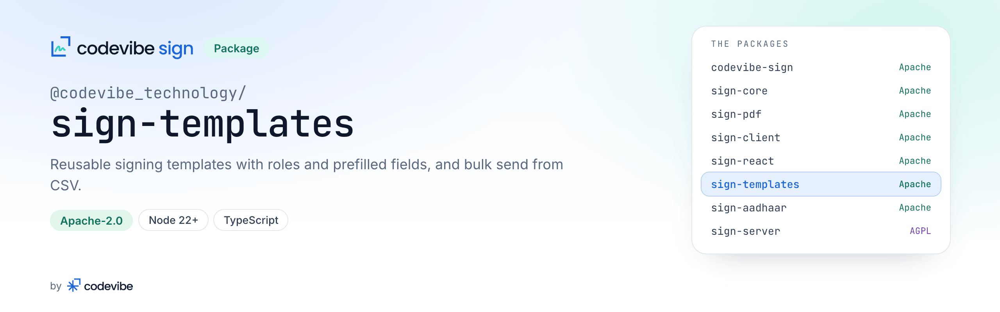

<p align="center">
  <a href="https://sign.codevibe.in?utm_source=github&utm_medium=readme&utm_campaign=sign-templates&utm_content=banner"></a>
</p>

<p align="center">
  <a href="https://www.npmjs.com/package/@codevibe_technology/sign-templates"></a>
  <a href="https://www.npmjs.com/package/@codevibe_technology/sign-templates"></a>
  
  
  <a href="https://github.com/codevibe-technology/codevibe-sign"></a>
</p>

<p align="center">
  <a href="https://sign.codevibe.in/docs?utm_source=github&utm_medium=readme&utm_campaign=sign-templates&utm_content=nav">Docs</a> ·
  <a href="https://sign.codevibe.in?utm_source=github&utm_medium=readme&utm_campaign=sign-templates&utm_content=nav">Try it free</a> ·
  <a href="https://github.com/codevibe-technology/codevibe-sign#packages">All packages</a> ·
  <a href="https://github.com/codevibe-technology/codevibe-sign/blob/main/LICENSING.md">Licensing</a> ·
  <a href="https://sign.codevibe.in/docs/changelog?utm_source=github&utm_medium=readme&utm_campaign=sign-templates&utm_content=nav">Changelog</a> ·
  <a href="https://github.com/codevibe-technology/codevibe-sign">GitHub</a>
</p>

# @codevibe_technology/sign-templates

Reusable signing templates for Codevibe Sign. A template describes an envelope once (documents,
routing, reminders, expiry and the fields to fill) for roles such as `Employee` and `HR`
rather than for named people. You turn it into a draft envelope by saying who takes each role,
or into hundreds of drafts from a CSV file.

Envelopes are built with `@codevibe_technology/sign-core`'s builder functions, so every core rule applies
and the result is ready for core's `send`. No I/O; time, ids and hashing are passed in.

## Install

```sh
pnpm add @codevibe_technology/sign-templates @codevibe_technology/sign-core
```

## Usage

An offer letter: the employee signs first, then HR countersigns. The employee code is filled
in by HR and the employee cannot change it.

<!-- check:
declare const sha256: string;
declare const pageSizes: { width: number; height: number }[];
-->

```ts check
import { randomIds, systemClock, webCryptoHasher } from '@codevibe_technology/sign-core';
import { instantiate, type Template } from '@codevibe_technology/sign-templates';

const offer: Template = {
  id: 'offer-letter',
  title: 'Offer letter',
  message: 'Welcome aboard. Please review and sign your offer.',
  expiresInDays: 14,
  documents: [{ name: 'offer.pdf', fileKey: 'templates/offer.pdf', sha256, pageSizes }],
  roles: [
    {
      name: 'Employee',
      fields: [
        {
          document: 'templates/offer.pdf',
          type: 'text',
          page: 0,
          rect: { x: 72, y: 120, width: 160, height: 20 },
          label: 'Employee code',
          readOnly: true,
        },
        {
          document: 'templates/offer.pdf',
          type: 'signature',
          page: 1,
          rect: { x: 72, y: 640, width: 180, height: 48 },
        },
      ],
    },
    {
      name: 'HR',
      auth: 'email_otp',
      fields: [
        {
          document: 'templates/offer.pdf',
          type: 'signature',
          page: 1,
          rect: { x: 340, y: 640, width: 180, height: 48 },
        },
      ],
    },
  ],
};

const deps = { clock: systemClock, ids: randomIds, hasher: webCryptoHasher };

const created = await instantiate(
  offer,
  {
    roles: {
      Employee: { name: 'Asha Rao', email: 'asha@example.com' },
      HR: { name: 'Meera Iyer', email: 'hr@example.com' },
    },
    prefill: { 'Employee code': 'EMP-0042' },
    metadata: { employeeId: 'E42' },
  },
  deps,
);
// created is core's TransitionResult: commit its `envelope.created` event, then call send().
```

### Bulk send to 50 new joiners

`joiners.csv`, exported from a spreadsheet:

```csv
Employee name,Employee email,Employee code,meta.employeeId
"Rao, Asha",asha@example.com,EMP-1001,E1001
Ravi Kumar,ravi@example.com,EMP-1002,E1002
...
```

HR is the same for everyone, so it goes in `defaults` instead of the file.

<!-- check:
import { randomIds, systemClock, webCryptoHasher } from '@codevibe_technology/sign-core';
import type { Template } from '@codevibe_technology/sign-templates';
declare const csvText: string;
declare const offer: Template;
const deps = { clock: systemClock, ids: randomIds, hasher: webCryptoHasher };
-->

```ts check
import { parseBulkCsv, planBulkSend } from '@codevibe_technology/sign-templates';

const parsed = parseBulkCsv(csvText, offer);
const plan = await planBulkSend(offer, parsed.rows, deps, {
  defaults: { roles: { HR: { name: 'Meera Iyer', email: 'hr@example.com' } } },
});

const problems = [...parsed.errors, ...plan.errors];
// [{ line: 7, column: 'Employee email', message: 'Missing Employee email' }, ...]
for (const { result } of plan.planned) {
  // commit result.events, then send(result.envelope, deps)
}
```

Nothing throws for bad rows. Every problem comes back with its CSV line, so you can show the
whole list at once and send the good rows, or fix the file first.

## Templates

| Property           | Notes                                                                      |
| ------------------ | -------------------------------------------------------------------------- |
| `title`, `message` | Copied to each envelope.                                                   |
| `routing`          | `sequential` (default) or `parallel`.                                      |
| `reminders`        | Core's `ReminderPolicy`; defaults to `DEFAULT_REMINDERS`.                  |
| `expiresInDays`    | Whole days from creation. Leave out for no expiry.                         |
| `documents`        | `{ name, fileKey, sha256, pageSizes }`. Fields refer to them by `fileKey`. |
| `roles`            | `{ name, type?, order?, auth?, fields? }`. Names are unique, any case.     |
| `roles[].fields`   | `{ document, type, page, rect, required?, label?, readOnly? }`.            |
| `id`, `metadata`   | Copied into each envelope's metadata.                                      |

Role `type` is `signer` (default), `approver` or `viewer`. In sequential routing a role's
`order` defaults to its position among signers and approvers; give two roles the same order to
let them act together.

Validation follows core's rules: every field sits inside its page, viewers have no fields, and
every signer role has a required signature field. Problems are reported with a path such as
`roles.0.fields.1.rect`.

### Prefill and read-only fields

`prefill` sets text fields by their label (any case). The values are stored on the draft as
`envelope.values`.

- A field marked `readOnly: true` is locked: it must get a value when it is required, and it
  is placed with core's `readOnly` flag, so core's `submit` refuses any change to it with
  `FIELD_NOT_YOURS` and counts the prefilled value towards required fields. Use
  `readOnlyFieldIds(envelope)` to show those fields as plain text in your signing view. An
  optional read-only field left without a value stays editable.
- Envelopes created by earlier versions list locked fields in
  `envelope.metadata.templateReadOnlyFields` instead. `readOnlyFieldIds` still reads that key,
  and `assertWritable(envelope, values)` refuses changes to those fields before `submit`.
- Any other prefilled field is a suggestion. The recipient sees it and may change it; a
  required one is still sent back with the signature.

### Metadata written to each envelope

| Key               | Value                                    |
| ----------------- | ---------------------------------------- |
| `templateVersion` | `templateVersion(template)` at creation. |
| `templateId`      | `template.id`, when set.                 |

These win over metadata with the same keys from the template or the input.

## API

| Export                                                       | Notes                                                                           |
| ------------------------------------------------------------ | ------------------------------------------------------------------------------- |
| `validateTemplate(template)` → `ValidationIssue[]`           | Empty means usable.                                                             |
| `assertValidTemplate(template)`                              | Throws `SignError` `VALIDATION` with `details.issues`.                          |
| `instantiate(template, input, { clock, ids, hasher })`       | `Promise<TransitionResult>` with a draft envelope. Throws `VALIDATION`.         |
| `readOnlyFieldIds(envelope)` → `string[]`                    | Locked field ids, including those under the old metadata key.                   |
| `assertWritable(envelope, values)`                           | Throws `INVALID_FIELD_VALUE` for a locked field; needed only for old envelopes. |
| `templateVersion(template, hasher)` → `Promise<string>`      | SHA-256 hex of the canonical template.                                          |
| `canonicalJson(value)`, `normalizeTemplate(template)`        | The pieces `templateVersion` is built from.                                     |
| `parseCsv(text)` → `{ records, error? }`                     | RFC 4180, quotes, CRLF/LF/CR, BOM; skips empty lines; one-based line numbers.   |
| `parseBulkCsv(text, template)` → `{ columns, rows, errors }` | Maps columns to roles, prefill labels and metadata; row errors never throw.     |
| `planBulkSend(template, rows, deps, { defaults? })`          | `Promise<{ envelopes, planned, errors }>`; failing rows do not stop the others. |
| `METADATA_KEYS`                                              | The metadata key names above.                                                   |

`InstantiateInput` is `{ roles: { [role]: { name, email?, phone?, auth? } }, prefill?,
metadata?, overrides? }`, where `overrides` may set `title`, `message`, `routing`,
`reminders`, `expiresInDays` or an exact `expiresAt`.

### Bulk CSV columns

| Heading                                       | Meaning                   |
| --------------------------------------------- | ------------------------- |
| `<Role> name`, `<Role> email`, `<Role> phone` | The person for that role. |
| A text field's label, e.g. `Employee code`    | Prefill value.            |
| `meta.<key>` (or `metadata.<key>`)            | Envelope metadata.        |

Headings are matched in any case, with spaces, dots, dashes or underscores between words.
Phone numbers are in international format (`+919876543210`); spaces and dashes are removed.
Row checks: a missing name, a missing or invalid email, an invalid phone, more values than
columns, and a duplicate row (the same people as an earlier row). Unknown, blank and repeated
headings are reported on line 1.

### Versions

`templateVersion` hashes the template with its defaults written out and its keys sorted, so
reordering keys or spelling out a default keeps the version, while any change to what an
envelope would contain gives a new one. Store templates by version if you need to show later
exactly which definition produced an envelope.

## Docs

Guides and the full API reference are at [sign.codevibe.in](https://sign.codevibe.in?utm_source=github&utm_medium=readme&utm_campaign=sign-templates&utm_content=body).

## Licence

Apache-2.0 © Codevibe

---

### The Codevibe Sign packages

| Package                                                                                                    | What it does                                                                                        | Licence    |
| ---------------------------------------------------------------------------------------------------------- | --------------------------------------------------------------------------------------------------- | ---------- |
| [`codevibe-sign`](https://www.npmjs.com/package/codevibe-sign)                                             | The one library to install: API client, PDF tools, core rules, React components and a command line. | Apache-2.0 |
| [`@codevibe_technology/sign-core`](https://www.npmjs.com/package/@codevibe_technology/sign-core)           | Envelopes, routing, reminders, expiry and a hash-chained audit log. No I/O.                         | Apache-2.0 |
| [`@codevibe_technology/sign-pdf`](https://www.npmjs.com/package/@codevibe_technology/sign-pdf)             | Draws fields, appends the certificate page, seals with PAdES and verifies the seal.                 | Apache-2.0 |
| [`@codevibe_technology/sign-client`](https://www.npmjs.com/package/@codevibe_technology/sign-client)       | Typed client for the HTTP API, signing sessions and webhook checks. No dependencies.                | Apache-2.0 |
| [`@codevibe_technology/sign-react`](https://www.npmjs.com/package/@codevibe_technology/sign-react)         | Signature pad, signing view and field placer for your own React app.                                | Apache-2.0 |
| [`@codevibe_technology/sign-templates`](https://www.npmjs.com/package/@codevibe_technology/sign-templates) | Templates with roles and prefilled fields, and bulk send from CSV.                                  | Apache-2.0 |
| [`@codevibe_technology/sign-aadhaar`](https://www.npmjs.com/package/@codevibe_technology/sign-aadhaar)     | Aadhaar eSign through a licensed eSign provider (Leegality). Used by the server and the web app.    | Apache-2.0 |
| [`@codevibe_technology/sign-server`](https://www.npmjs.com/package/@codevibe_technology/sign-server)       | The HTTP API and runtime: storage, mail, one-time codes, webhooks and sealing.                      | AGPL-3.0   |

The web app, the Docker image and the docs live in the [Codevibe Sign repository](https://github.com/codevibe-technology/codevibe-sign). Try it free at [sign.codevibe.in](https://sign.codevibe.in?utm_source=github&utm_medium=readme&utm_campaign=sign-templates&utm_content=footer), or self-host it with no limits.

<p align="center">
  <a href="https://codevibe.in?utm_source=github&utm_medium=readme&utm_campaign=sign-templates&utm_content=footer-logo">
    <picture>
      <source media="(prefers-color-scheme: dark)" srcset="https://raw.githubusercontent.com/codevibe-technology/codevibe-sign/main/.github/assets/codevibe-logo-light.png">
      
    </picture>
  </a>
</p>

<p align="center">
  Built and maintained by <a href="https://codevibe.in?utm_source=github&utm_medium=readme&utm_campaign=sign-templates&utm_content=built-by"><b>Codevibe</b></a>, a software development agency in Gurugram, India.<br>
  <a href="https://sign.codevibe.in?utm_source=github&utm_medium=readme&utm_campaign=sign-templates&utm_content=footer-links">Codevibe Sign</a> · <a href="https://sign.codevibe.in/docs?utm_source=github&utm_medium=readme&utm_campaign=sign-templates&utm_content=footer-links">Docs</a> · <a href="https://codevibe.in/tools/codevibe-sign?utm_source=github&utm_medium=readme&utm_campaign=sign-templates&utm_content=footer-links">Product page</a> · <a href="mailto:hello@codevibe.in">hello@codevibe.in</a>
</p>
